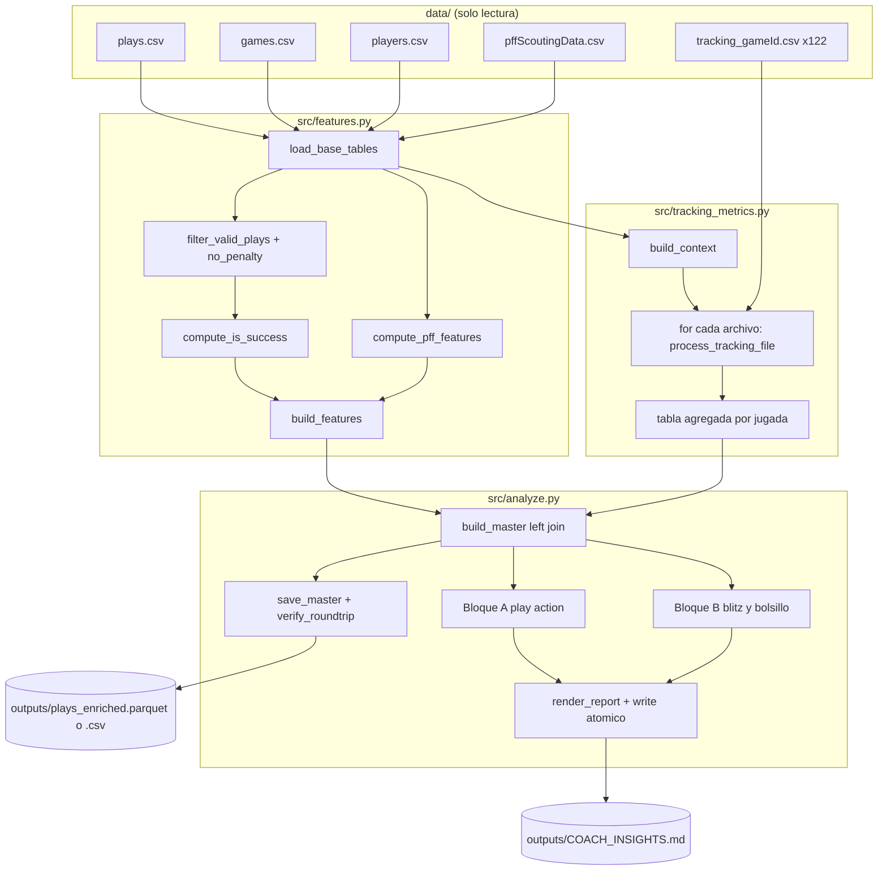

# Design Document

## Overview

El pipeline construye una tabla maestra a nivel jugada (`gameId`, `playId`) para el perfil Coach y genera `outputs/COACH_INSIGHTS.md` con intervalos de confianza al 95%. Tiene tres módulos en `src/`:

- `src/features.py`: carga y valida las tablas base, filtra jugadas válidas, calcula `is_success` y las métricas PFF (`n_rushers`, `n_blockers`, `protection_advantage`, `is_blitz`, `any_pressure`, `any_beaten`).
- `src/tracking_metrics.py`: procesa los 122 archivos de tracking uno a la vez y agrega por jugada `time_to_throw`, `frame_dt_ok`, `min_rusher_dist_at_throw` y `lb_bite_yards`.
- `src/analyze.py`: orquesta el pipeline, une y persiste la tabla maestra, calcula la estadística y escribe el reporte (Bloque A de play action y Bloque B de blitz y bolsillo).

Restricciones de diseño (de `.kiro/steering/rules.md` y del requirements.md): solo pandas 2.2.3, numpy 2.1.3 y biblioteca estándar; Python 3.12 en `.venv`; `data/` solo lectura; rutas relativas a la raíz del proyecto; escrituras solo en `outputs/`; un solo archivo de tracking en memoria a la vez; ningún módulo ejecuta código al importarse.

### Decisiones de diseño

| # | Decisión | Motivo |
|---|---|---|
| D1 | Un `RunReport` (dataclass con contadores y avisos) viaja por todas las funciones. Es el Reporte_Ejecucion. | Los requisitos piden registrar exclusiones y conteos en varios módulos. |
| D2 | Jugada_Valida se define por `down` en {1,2,3,4}. Las jugadas con `prePenaltyPlayResult` o `yardsToGo` nulos o no numéricos se excluyen de la tabla de features y se cuentan en `RunReport` (req. 2.5). | `is_success` no puede ser nulo (req. 2.4). Según `DATA_CONTEXT.md` esas columnas son `int64` sin nulos, así que en los datos reales el conteo esperado es 0. |
| D3 | `Frame_Resolucion` es el primer frame con evento de resolución cuyo `time` es mayor o igual al del Frame_Snap. La regla de `time_to_throw < 0` (req. 5.6) queda como guarda defensiva. | Evita una contradicción entre el glosario y el criterio 5.6. Si hay snap pero todos los eventos de resolución son anteriores, `time_to_throw` es nulo. |
| D12 | `time_to_throw = (res_frameId − snap_frameId) / 10` y `frame_dt_ok` se basa en `frameId` (saltos de 1) y en que `time` sea monótono no decreciente. Se agrega `mean_dt_time` (diagnóstico). | Hallazgo de la tarea 8.1: `time` viene truncado al segundo (`YYYY-MM-DDTHH:MM:SSZ`), 90% de los pares consecutivos tiene dt = 0, mientras `frameId` avanza de 1 en 1 a 10 Hz. Con `time`, `time_to_throw` tenía error de hasta ±1 s y `frame_dt_ok` daba 63%. |
| D4 | El frame "snap + 10" es el frame con `frameId == snap_frameId + 10` dentro de la jugada. Si no existe, `lb_bite_yards` es nulo. | Es la lectura literal de "menos de 10 frames posteriores" y no supone 10 Hz. `frame_dt_ok` informa si el supuesto de 1.0 s es razonable. |
| D5 | El IC95 de la diferencia de proporciones usa el método híbrido de Newcombe (con límites de Wilson). El de la diferencia de medias usa Welch con z = 1.96. | El requisito fija Wilson para tasas, así que la diferencia se construye sobre Wilson. Newcombe se comporta bien con n pequeño y tasas cercanas a 0 o 1. |
| D6 | Para métricas continuas, varianza cero implica "no calculable" en el Bloque B (req. 10.7). Las binarias usan Wilson, que funciona con varianza cero. | Cumple el requisito sin descartar tasas de 0 o 1, que son informativas. |
| D7 | Los rangos de `lb_bite_yards` del Bloque A son cuartiles de la muestra, con bordes redondeados a 2 decimales y declarados en el reporte. | Equilibra n por rango. Los bordes fijos arriesgan rangos casi vacíos porque la distribución no se ha observado. |
| D8 | El valor de `team` del tracking se normaliza a abreviatura de equipo. Si los valores son `home`/`away`, se mapean con `games.homeTeamAbbr` y `visitorTeamAbbr`. Si ya son abreviaturas, se usan tal cual. | `DATA_CONTEXT.md` solo confirma `football`. La comparación con `plays.defensiveTeam` exige abreviaturas. |
| D9 | `pyarrow` se detecta con `importlib.util.find_spec("pyarrow")` sin importarlo. La escritura usa `DataFrame.to_parquet`. | Cumple "solo pandas, numpy y stdlib" y el requisito 7.3 y 7.4. |
| D10 | Las columnas de resultado de tracking incluyen `n_speed_outliers` y `max_speed_player` como diagnóstico, además de las pedidas. | El requisito 4.7 obliga a filtrar `s > 15` pero ninguna métrica pedida usa velocidad. Estas columnas dan un destino verificable al filtro. No se usan en el reporte. |
| D11 | Los tests de propiedades usan `numpy.random.default_rng(seed)` con 100 iteraciones o más. No se agrega `hypothesis`. | Restricción de dependencias. |

### Investigación y hallazgos que informan el diseño

Fuente única: `DATA_CONTEXT.md` y `requirements.md` del proyecto (no se necesitó búsqueda externa).

- Tracking: 8,360,171 filas en 122 archivos (≈ 68,500 filas por archivo en promedio, 810 MB en total). El balón es la fila con `team == "football"` y `nflId` nulo.
- Los eventos aparecen repetidos en cada fila del frame (~23 filas por frame), por lo que se deduplica a nivel frame antes de buscar el primero.
- `s` máxima observada de 27.77 yd/s probablemente es del balón o un error de medición. De ahí el filtro de `s > 15` y la exclusión del balón.
- `pff_role` usa mayúscula inicial en cada palabra (`Pass Block`, `Pass Rush`). Se compara con igualdad exacta.
- `time` tiene resolución de 1 s (verificado en los 122 archivos), por lo que no sirve para medir 0.1 s. Los tiempos se derivan de `frameId` a 10 Hz (D12). `frame_dt_ok` verifica que `frameId` no tenga saltos y que `time` no retroceda, y el reporte informa cuántas jugadas lo cumplen.
- `plays.csv` solo tiene jugadas de pase, así que `is_success` y los bloques A y B describen dropbacks.

## Architecture

### Flujo de datos



### Procesamiento de un archivo de tracking

```mermaid
sequenceDiagram
    participant O as run_pipeline
    participant TM as compute_tracking_metrics
    participant PF as process_tracking_file
    participant GC as gc

    O->>TM: ctx, tracking_dir, run
    loop cada tracking_[gameId].csv, orden por gameId
        TM->>PF: path, ctx
        PF->>PF: read_csv(usecols, dtype)
        PF->>PF: normalizar x,y; time a segundos
        PF->>PF: frames snap/resolucion, time_to_throw, frame_dt_ok
        PF->>PF: pasador, min_rusher_dist, lb_bite
        PF-->>TM: DataFrame agregado (1 fila por jugada)
        TM->>TM: guardar solo el agregado
        TM->>GC: del df; gc.collect()
    end
    TM-->>O: DataFrame concatenado + conteos ok/error
```

### Estructura de archivos

```
src/
  features.py
  tracking_metrics.py
  analyze.py
tests/                      (opcional, pytest 8.3.5)
  helpers.py                (generadores sembrados con numpy)
  test_features.py
  test_tracking_metrics.py
  test_stats.py
  test_master_and_report.py
outputs/                    (se crea al ejecutar)
  plays_enriched.parquet | plays_enriched.csv
  COACH_INSIGHTS.md
```

`src/` ya existe con `explore.py`. Se agrega `src/__init__.py` vacío para que `backend/main.py` pueda hacer `from src import analyze` con la raíz del proyecto en `sys.path`.

## Components and Interfaces

Todas las funciones son importables sin efectos al importar: no hay código a nivel de módulo más allá de constantes, dataclasses y definiciones de funciones. La ejecución por línea de comandos vive solo en `main()` dentro de `if __name__ == "__main__":`. Se invoca con `.venv/bin/python -m src.analyze`.

### `src/features.py`

```python
PROJECT_ROOT: Path   # Path(__file__).resolve().parent.parent
DATA_DIR: Path       # PROJECT_ROOT / "data/nfl-big-data-bowl-regional-event-data/data"
TRACKING_DIR: Path   # DATA_DIR / "tracking"
OUTPUT_DIR: Path     # PROJECT_ROOT / "outputs"

ROLE_PASS_RUSH = "Pass Rush"; ROLE_PASS_BLOCK = "Pass Block"; ROLE_PASS = "Pass"
VALID_DOWNS = (1, 2, 3, 4)
SUCCESS_THRESHOLD = {1: 0.4, 2: 0.6, 3: 1.0, 4: 1.0}

class PipelineError(Exception): ...        # error fatal con mensaje claro

@dataclass
class RunReport:                           # Reporte_Ejecucion
    counts: dict[str, int]                 # p. ej. "plays_excluded_is_success", "tracking_ok"
    warnings: list[str]
    def add(self, key: str, n: int = 1) -> None: ...
    def warn(self, msg: str) -> None: ...  # también escribe en logging

def load_base_tables(data_dir: Path = DATA_DIR) -> dict[str, pd.DataFrame]
    # claves: plays, games, players, pff. Solo lectura (open 'r' via read_csv).
    # Lanza PipelineError con la ruta o columna faltante (req. 1.6, 1.7, 3.9).

def filter_valid_plays(plays: pd.DataFrame) -> pd.DataFrame
    # down en {1,2,3,4}; agrega no_penalty = penaltyYards.isna() (bool, sin nulos).

def compute_is_success(plays: pd.DataFrame, run: RunReport | None = None) -> pd.DataFrame
    # Excluye filas con yardsToGo/prePenaltyPlayResult nulos o no numéricos y las cuenta.
    # Agrega is_success int8 en {0,1}.

def compute_pff_features(pff: pd.DataFrame) -> pd.DataFrame
    # Una fila por (gameId, playId) presente en PFF:
    # n_rushers, n_blockers, protection_advantage, is_blitz, any_pressure, any_beaten.

def attach_positions(pff: pd.DataFrame, players: pd.DataFrame) -> pd.DataFrame
    # Left join por nflId para agregar officialPosition; no cambia el número de filas.

def build_features(tables: dict | None = None, run: RunReport | None = None) -> pd.DataFrame
    # plays válidas + games + PFF (left join por llave). Una fila por (gameId, playId).
```

`compute_pff_features` es vectorizado:

```python
role = pff["pff_role"]
rush, block = role.eq("Pass Rush"), role.eq("Pass Block")
flag = lambda c: pff[c].fillna(0).eq(1)
g = pff.assign(
    _rush=rush, _block=block,
    _press=rush & (flag("pff_hit") | flag("pff_hurry") | flag("pff_sack")),
    _beaten=block & flag("pff_beatenByDefender"),
).groupby(["gameId", "playId"], as_index=False).agg(
    n_rushers=("_rush", "sum"), n_blockers=("_block", "sum"),
    any_pressure=("_press", "max"), any_beaten=("_beaten", "max"))
g["protection_advantage"] = g.n_blockers - g.n_rushers
g["is_blitz"] = (g.n_rushers >= 5)
# flags a Int8; jugadas sin PFF quedan nulas tras el left join
```

### `src/tracking_metrics.py`

```python
TRACKING_COLUMNS = ["gameId","playId","nflId","frameId","time","team",
                    "playDirection","x","y","s","a","event"]
TRACKING_DTYPES = {"gameId":"int32","playId":"int32","nflId":"float64","frameId":"int16",
                   "team":"category","playDirection":"category","event":"category",
                   "x":"float64","y":"float64","s":"float32","a":"float32"}   # time se lee como str
SNAP_EVENTS = {"ball_snap","autoevent_ballsnap"}
RESOLUTION_EVENTS = {"pass_forward","autoevent_passforward","qb_sack","qb_strip_sack"}
LB_POSITIONS = {"ILB","MLB","OLB","LB"}
SPEED_MAX = 15.0
BITE_OFFSET_FRAMES = 10

@dataclass
class TrackingContext:
    pff_roles: pd.DataFrame      # gameId, playId, nflId, pff_role, officialPosition
    plays_def: pd.DataFrame      # gameId, playId, defensiveTeam
    positions: pd.Series         # index nflId -> officialPosition
    team_map: dict[int, dict]    # gameId -> {"home": abbr, "away": abbr}

def build_context(tables: dict, features: pd.DataFrame) -> TrackingContext

# funciones puras sobre DataFrames (probables con datos sintéticos)
def normalize_xy(df) -> pd.DataFrame             # agrega x_norm, y_norm; excluye playDirection inválido
def filter_speed(df, smax=SPEED_MAX) -> pd.DataFrame   # pone NaN a s > smax (no borra posición)
def add_time_seconds(df) -> pd.DataFrame         # time (str) -> time_s (float64, relativo)
def find_event_frames(df) -> pd.DataFrame        # snap_frameId, snap_time, res_frameId, res_time, time_to_throw
def frame_dt_flags(df) -> pd.DataFrame           # n_frames, frame_dt_ok, mean_dt_time
def select_passer(df, roles, positions) -> pd.DataFrame    # passer_nflId, passer_source, passer_ambiguous
def rusher_distance(df, frames, roles, passer) -> pd.DataFrame   # min_rusher_dist_at_throw
def lb_bite(df, frames, ctx_lb, game_id) -> pd.DataFrame         # lb_bite_yards, n_lb_used

def process_tracking_frame(df, game_ctx) -> pd.DataFrame   # núcleo sin I/O: una fila por jugada
def process_tracking_file(path, ctx, run=None) -> pd.DataFrame  # I/O + núcleo
def compute_tracking_metrics(tracking_dir, ctx, run=None, game_ids=None)
        -> tuple[pd.DataFrame, dict]    # (agregado, {"ok": n, "error": m, "attempted": k})
```

El núcleo `process_tracking_frame` no toca disco. Esto permite probarlo con DataFrames sintéticos y reutilizarlo en el backend.

### `src/analyze.py`

```python
# Pipeline
def build_master(features, tracking, run=None) -> pd.DataFrame     # left join, has_tracking
def detect_format() -> tuple[str, str]       # ("parquet"|"csv", motivo)
def save_master(master, out_dir=OUTPUT_DIR, run=None) -> Path       # atómico
def load_master(out_dir=OUTPUT_DIR) -> pd.DataFrame | None
def verify_roundtrip(master, path) -> None   # lanza PipelineError si difiere
def run_pipeline(out_dir=OUTPUT_DIR, data_dir=DATA_DIR, write=True) -> tuple[pd.DataFrame, RunReport]
def load_or_build_master(...) -> pd.DataFrame   # para el backend

# Estadística (funciones puras)
def wilson_ci(k: int, n: int, z=1.96) -> tuple[float, float] | None
def mean_ci(x: np.ndarray, z=1.96) -> tuple[float, float, float] | None   # (media, lo, hi)
def summarize_cell(values, kind: Literal["binary","continuous"], label: str) -> CellStats
def diff_means_ci(x1, x0, z=1.96) -> DiffStats
def diff_props_ci(k1, n1, k0, n0, z=1.96) -> DiffStats       # Newcombe
def quartile_edges(values) -> list[float]
def assign_bins(values, edges) -> np.ndarray
def merge_small_bins(counts: pd.Series, min_n=30, max_bins=5) -> list[tuple[int, int]]

# Bloques y reporte
def build_block_a(master, run) -> BlockA
def build_block_b(master, run) -> BlockB
def render_report(master, block_a, block_b, run) -> str
def write_report_atomic(text, path=OUTPUT_DIR / "COACH_INSIGHTS.md") -> None
def main(argv=None) -> int                      # código de salida 0 o 1
```

### Cómo reutiliza el backend FastAPI estas funciones

`backend/main.py` agrega la raíz del proyecto a `sys.path` y expone la API sin duplicar lógica:

```python
from src import analyze                      # sin efectos al importar

_cache: dict = {}
@app.on_event("startup")                     # o lifespan; calcula en un hilo para no bloquear /health
def _warm(): ...                             # _cache["master"] = analyze.load_or_build_master()

@app.get("/api/coach/play-action")
def play_action():
    m = _cache["master"]                     # si aún no está listo: 503 con mensaje
    return analyze.build_block_a(m, RunReport()).to_dict()

@app.get("/api/coach/blitz")
def blitz():
    return analyze.build_block_b(_cache["master"], RunReport()).to_dict()
```

`load_or_build_master` lee `outputs/plays_enriched.*` si existe y, si no, ejecuta `run_pipeline(write=False)` en memoria. Si la escritura falla en el servidor efímero, la solicitud continúa con la tabla en memoria (req. 11.4). `/health` no depende del cálculo. Los dataclasses de bloques tienen `to_dict()` con tipos nativos de Python (`float`, `int`, `str`, `None`) para serializar con FastAPI. El frontend llama `fetch('api/coach/play-action')` sin diagonal inicial.

## Data Models

### Tablas base (entradas)

| Tabla | Columnas requeridas por el pipeline |
|---|---|
| `plays` | `gameId`, `playId`, `down`, `yardsToGo`, `prePenaltyPlayResult`, `playResult`, `penaltyYards`, `quarter`, `possessionTeam`, `defensiveTeam`, `yardlineSide`, `yardlineNumber`, `gameClock`, `preSnapHomeScore`, `preSnapVisitorScore`, `passResult`, `offenseFormation`, `personnelO`, `personnelD`, `defendersInBox`, `dropBackType`, `pff_playAction`, `pff_passCoverage`, `pff_passCoverageType` |
| `games` | `gameId`, `season`, `week`, `gameDate`, `homeTeamAbbr`, `visitorTeamAbbr` |
| `players` | `nflId`, `officialPosition` (el resto no se usa) |
| `pff` | `gameId`, `playId`, `nflId`, `pff_role`, `pff_hit`, `pff_hurry`, `pff_sack`, `pff_beatenByDefender` |
| `tracking` | las 12 columnas de `TRACKING_COLUMNS` |

Faltar `down`, `prePenaltyPlayResult` o `playResult` en `plays`, o cualquiera de las columnas de PFF, produce `PipelineError` (req. 1.7, 3.9).

### Tabla de features (`build_features`)

Una fila por (`gameId`, `playId`) válida.

| Grupo | Columnas |
|---|---|
| Llave | `gameId` int32, `playId` int32 |
| Juego | `season`, `week`, `gameDate`, `homeTeamAbbr`, `visitorTeamAbbr` |
| Situación | `quarter`, `down`, `yardsToGo`, `possessionTeam`, `defensiveTeam`, `yardlineSide`, `yardlineNumber`, `gameClock`, `preSnapHomeScore`, `preSnapVisitorScore` |
| Resultado | `passResult`, `prePenaltyPlayResult`, `playResult`, `penaltyYards`, `no_penalty` (bool) |
| Esquema | `offenseFormation`, `personnelO`, `personnelD`, `defendersInBox`, `dropBackType`, `pff_playAction`, `pff_passCoverage`, `pff_passCoverageType` |
| Objetivo | `is_success` int8 en {0,1} |
| PFF | `n_rushers`, `n_blockers`, `protection_advantage` (Int16), `is_blitz`, `any_pressure`, `any_beaten` (Int8). Nulos si la jugada no tiene registros PFF |

### Tabla de tracking agregado (`compute_tracking_metrics`)

Una fila por (`gameId`, `playId`) observada en los archivos procesados.

| Columna | Tipo | Significado |
|---|---|---|
| `gameId`, `playId` | int32 | llave |
| `n_frames` | int16 | frames distintos de la jugada |
| `snap_frameId`, `res_frameId` | Int16 | frames de snap y resolución (nulos si no hay) |
| `time_to_throw` | float64 | segundos, 2 decimales; nulo si falta snap o resolución |
| `frame_dt_ok` | int8 | 1 si hay ≥ 2 frames, `frameId` avanza de 1 en 1 y `time` es no decreciente (D12) |
| `mean_dt_time` | float32 | dt medio por `time` en segundos (diagnóstico; nulo con < 2 frames) |
| `passer_nflId` | Int64 | Pasador elegido |
| `passer_source` | string | `pff`, `qb_fallback` o nulo |
| `passer_ambiguous` | bool | hubo más de un candidato |
| `min_rusher_dist_at_throw` | float64 | yardas, 2 decimales |
| `n_lb_used` | Int8 | linebackers con valor en ambos frames |
| `lb_bite_yards` | float64 | yardas, 2 decimales; positivo = avance hacia la línea de golpeo |
| `n_speed_outliers` | int16 | filas de jugadores con `s > 15` (D10) |
| `max_speed_player` | float32 | `s` máxima de jugadores tras el filtro (D10) |

### Tabla maestra (`outputs/plays_enriched.*`)

Es la tabla de features con un left join del agregado de tracking por (`gameId`, `playId`). Conserva todas las columnas de ambas, más `has_tracking` (bool), verdadera si la jugada tiene fila en el agregado. El orden de columnas es: features, luego tracking sin la llave, luego `has_tracking`. Una fila por llave, sin duplicados (req. 7.1). Si falta el registro de un módulo, sus columnas quedan nulas y el número de jugadas afectadas se escribe en el Log (req. 7.2).

### Estructuras del reporte

```python
@dataclass
class CellStats:       # una Celda
    label: str; n: int
    mean: float | None; mean_lo: float | None; mean_hi: float | None
    success_rate: float | None; sr_lo: float | None; sr_hi: float | None
    flags: list[str]   # "no concluyente", "n insuficiente", "no calculable", "no disponible"

@dataclass
class DiffStats:       # comparación grupo 1 menos grupo 0
    n1: int; n0: int
    diff: float | None; lo: float | None; hi: float | None
    flags: list[str]
```

Redondeo: los valores se guardan sin redondear y se redondean a 3 decimales solo al renderizar y al construir `to_dict()`.

## Algoritmos

### Estrategia de memoria

1. `compute_tracking_metrics` itera `sorted(tracking_dir.glob("tracking_*.csv"))`. El bucle llama a `process_tracking_file`, guarda solo el DataFrame agregado en una lista y ejecuta `del df` y `gc.collect()` al terminar cada archivo. Nunca hay dos DataFrames de tracking vivos (req. 4.1, 4.3, 11.5).
2. `pd.read_csv(path, usecols=TRACKING_COLUMNS, dtype=TRACKING_DTYPES)` con el motor C. `time` se lee como `str` y se convierte con `add_time_seconds`, que factoriza `time` y parsea solo los valores únicos (≈ 1/23 de las filas) con `pd.to_datetime(uniques, errors="coerce")`, y luego mapea de vuelta con los códigos de factorización.
3. Los datos auxiliares (`pff_roles` del juego, `plays_def`) son pequeños y se filtran por `gameId` antes de unirlos.
4. Cada archivo produce a lo sumo ~200 filas agregadas. La concatenación final ronda 8,557 filas.

### Estimación de RAM

| Elemento | Estimación |
|---|---|
| Un archivo de tracking (≈ 68,500 filas promedio, hasta ≈ 200,000 en el peor caso) con 12 columnas tipadas | 15 a 25 MB tras tipado, hasta ≈ 60 MB en el peor caso (la columna `time` como str domina) |
| Columnas derivadas (`x_norm`, `y_norm`, `time_s`, máscaras) | +20 a 40 MB |
| Copias temporales de merges por jugada (frames de snap, resolución, snap+10) | < 20 MB |
| `pffScoutingData` completo (188,250 filas × 15 columnas) | ≈ 30 MB |
| `plays`, `games`, `players` | < 10 MB |
| Agregados acumulados (≈ 8.5k filas) | < 5 MB |
| Pico estimado | 150 a 250 MB, con margen < 400 MB |

La lectura total de 810 MB de CSV con el motor C se estima en 1 a 2 minutos. Es una estimación a confirmar con la primera corrida y se registra en el Log (`tiempo por archivo`).

### Normalización y filtros

```python
def normalize_xy(df):
    d = df["playDirection"]
    valid = d.isin(["left", "right"])
    bad = df.loc[~valid, ["gameId", "playId"]].drop_duplicates()   # se registra (req. 4.10)
    df = df[valid].copy()
    left = df["playDirection"].eq("left")
    df["x_norm"] = np.where(left, 120.0 - df["x"], df["x"])
    df["y_norm"] = np.where(left, 53.3 - df["y"], df["y"])
    return df, bad
```

Las filas con `team == "football"` se separan antes de las métricas de jugadores (req. 4.6). `filter_speed` pone `NaN` en `s` cuando `s > 15`; no borra la fila porque la posición es válida. `n_speed_outliers` cuenta esas filas.

### Snap, resolución y `time_to_throw` (vectorizado)

```python
KEYS = ["gameId", "playId"]

def find_event_frames(df):                       # df ya sin balón no es necesario: el evento está en todas las filas
    fr = (df[KEYS + ["frameId", "time_s", "event"]]
          .dropna(subset=["time_s"])
          .drop_duplicates(KEYS + ["frameId"]))  # un registro por frame
    snap = (fr[fr.event.isin(SNAP_EVENTS)]
            .sort_values(KEYS + ["time_s"]).groupby(KEYS, as_index=False).first()
            .rename(columns={"frameId": "snap_frameId", "time_s": "snap_time"})[KEYS + ["snap_frameId", "snap_time"]])
    res = fr[fr.event.isin(RESOLUTION_EVENTS)][KEYS + ["frameId", "time_s"]]
    res = res.merge(snap[KEYS + ["snap_time"]], on=KEYS, how="left")
    res = res[res.snap_time.isna() | (res.time_s >= res.snap_time)]      # D3
    res = (res.sort_values(KEYS + ["time_s"]).groupby(KEYS, as_index=False).first()
           .rename(columns={"frameId": "res_frameId", "time_s": "res_time"}))
    out = snap.merge(res[KEYS + ["res_frameId", "res_time"]], on=KEYS, how="outer")
    ttt = ((out.res_frameId - out.snap_frameId) / 10).round(2)            # 10 Hz (D12)
    out["time_to_throw"] = ttt.where(ttt >= 0)                           # req. 5.5 y 5.6
    return out
```

Notas: `drop_duplicates` por frame resuelve la repetición del evento en las ~23 filas. Si un frame tuviera eventos distintos en filas distintas, ambos se conservan como filas y el orden por `time_s` y `first()` elige el primero. `time_to_throw` usa `frameId` y no `time` (D12); la selección de snap y resolución sigue usando `time_s` y desempata por `frameId`. La guarda `ttt >= 0` descarta el caso raro de una resolución con `frameId` menor que el snap dentro del mismo segundo. Sin snap, `snap_time` es nulo y el resultado es nulo.

### `frame_dt_ok`

```python
fr = fr.sort_values(KEYS + ["frameId"])
g = fr.groupby(KEYS)
gap = (g.frameId.diff().notna() & (g.frameId.diff() != 1))     # salto de frameId
back = (g.time_s.diff() < 0)                                    # time retrocede
frame_dt_ok = ((n >= 2) & ~gap_any & ~back_any).astype("int8")
mean_dt_time = (t["max"] - t["min"]) / (t["size"] - 1)         # diagnóstico
```

`frame_dt_ok` es 1 si hay al menos 2 frames, los `frameId` ordenados avanzan siempre de 1 en 1 y `time_s` es monótono no decreciente al ordenar por `frameId` (req. 5.4 y 5.7). `mean_dt_time` conserva el promedio por `time` solo como diagnóstico: con `time` truncado al segundo ronda 0.1 s por jugada, pero no es una medida fiable por frame.

### Pasador, `min_rusher_dist_at_throw`

```python
def select_passer(frames_players, roles, positions):
    # 1) fuente principal: pff_role == "Pass"
    primary = roles[roles.pff_role.eq("Pass")].groupby(KEYS).nflId.agg(["min", "nunique"])
    # 2) respaldo solo para jugadas sin ningún "Pass":
    ids = pd.concat([frames_players[KEYS + ["nflId"]], roles[KEYS + ["nflId"]]]).dropna().drop_duplicates()
    ids = ids.merge(positions, left_on="nflId", right_index=True)
    qb = ids[ids.officialPosition.eq("QB")].groupby(KEYS).nflId.agg(["min", "nunique"])
    qb = qb[~qb.index.isin(primary.index)]
    # passer_nflId = min; passer_ambiguous = nunique > 1; passer_source = "pff" | "qb_fallback"
```

La ambigüedad se registra en el Log con `gameId` y `playId` (req. 6.3). El empate se resuelve con el menor `nflId`.

```python
res_rows = df.merge(frames[KEYS + ["res_frameId"]], left_on=KEYS + ["frameId"], right_on=KEYS + ["res_frameId"])
res_rows = res_rows.merge(roles[KEYS + ["nflId", "pff_role"]], on=KEYS + ["nflId"], how="left")
rush = res_rows[res_rows.pff_role.eq("Pass Rush")][KEYS + ["nflId", "x_norm", "y_norm"]]
pas  = res_rows.merge(passer[KEYS + ["passer_nflId"]], on=KEYS)
pas  = pas[pas.nflId == pas.passer_nflId][KEYS + ["x_norm", "y_norm"]]
d = rush.merge(pas, on=KEYS, suffixes=("_r", "_p"))
d["dist"] = np.hypot(d.x_norm_r - d.x_norm_p, d.y_norm_r - d.y_norm_p)
min_rusher = d.dropna(subset=["dist"]).groupby(KEYS).dist.min().round(2)
```

Nulo cuando no hay Pasador, rusher o coordenadas. El `dropna` descarta rushers sin coordenadas y, si el Pasador no tiene coordenadas, la jugada no aparece en `pas`. El `left` merge final con la tabla de jugadas deja el nulo (req. 6.4). Los `roles` salen de la unión por (`gameId`, `playId`, `nflId`) entre `pffScoutingData` y tracking.

### Linebackers y `lb_bite_yards`

```python
lb_ids = positions.index[positions.isin(LB_POSITIONS)]
defteam = plays_def  # gameId, playId, defensiveTeam
dfp = df[df.nflId.isin(lb_ids)].merge(defteam, on=KEYS)
dfp = dfp[dfp.team_abbr == dfp.defensiveTeam]                    # D8: team normalizado a abreviatura
a = dfp.merge(frames[KEYS + ["snap_frameId"]], left_on=KEYS + ["frameId"], right_on=KEYS + ["snap_frameId"])
b = dfp.assign(snap_frameId=dfp.frameId - BITE_OFFSET_FRAMES)    # el frame b se alinea con snap_frameId
b = b.merge(frames[KEYS + ["snap_frameId"]], on=KEYS + ["snap_frameId"])
m = a[KEYS + ["nflId", "x_norm"]].merge(b[KEYS + ["nflId", "x_norm"]], on=KEYS + ["nflId"], suffixes=("_0", "_10"))
m = m.dropna(subset=["x_norm_0", "x_norm_10"])
m["bite"] = m.x_norm_0 - m.x_norm_10                              # positivo: mordió (avanzó hacia -X)
lb = m.groupby(KEYS).agg(lb_bite_yards=("bite", "mean"), n_lb_used=("bite", "size"))
lb["lb_bite_yards"] = lb.lb_bite_yards.round(2)
```

Con `x_norm` ofensivo hacia +X, la defensa está en X mayor y un linebacker que avanza hacia la línea de golpeo reduce su `x_norm`, así que `x_norm(snap) − x_norm(snap+10) > 0` indica avance (req. 6.5). Si la jugada no tiene frame `snap_frameId + 10`, no hay `b` y `lb_bite_yards` es nulo. Los linebackers sin valor en alguno de los dos frames salen en el `dropna` y el promedio usa el resto (req. 6.7).

### Estadística

| Función | Fórmula |
|---|---|
| `wilson_ci(k, n)` | `p = k/n`, `den = 1 + z²/n`, `centro = (p + z²/(2n))/den`, `half = z·sqrt(p(1−p)/n + z²/(4n²))/den`; devuelve `(centro−half, centro+half)` recortado a [0,1]. `n = 0` devuelve `None` |
| `mean_ci(x)` | `m ± 1.96·s/√n` con `s` muestral (`ddof=1`). `n < 2` devuelve `None` |
| `diff_means_ci(x1, x0)` | `d = m1 − m0`, `se = sqrt(s1²/n1 + s0²/n0)`, IC `d ± 1.96·se`. Requiere `n1 ≥ 2` y `n0 ≥ 2` |
| `diff_props_ci(k1,n1,k0,n0)` | Newcombe: con `p1, p0` y límites Wilson `(l1,u1)`, `(l0,u0)`: `lo = d − sqrt((p1−l1)² + (u0−p0)²)`, `hi = d + sqrt((u1−p1)² + (p0−l0)²)`. Requiere `n1 ≥ 2` y `n0 ≥ 2` |

Reglas de etiquetado de una Celda:

- Bloque A: `n < 30` agrega "no concluyente"; `n ≤ 1` pone los IC en "no disponible" y agrega "no concluyente" (req. 8.6, 8.7).
- Bloque B: `n < 30` pone "n insuficiente" y omite el IC95 pero conserva `n`; métrica continua con varianza cero o sin valores pone "no calculable" (req. 10.7, D6).
- Diferencias del Bloque A: un grupo con cero jugadas deja "no disponible" la diferencia y su IC95 y conserva los `n`; un grupo con una sola jugada deja "no disponible" solo el IC95 y conserva la diferencia puntual (req. 9.8, 9.9).

### Bloque A: play action

Universo: Jugadas con `pff_playAction` no nulo; el número de excluidas se declara. Grupos: `pff_playAction == 1` frente a `== 0`. Para cada comparación se reportan `n1`, `n0`, diferencia de `prePenaltyPlayResult` (Welch), de `playResult` (Welch) y de tasa de éxito en puntos porcentuales (Newcombe). Desgloses, cada uno con su conteo de excluidas por nulo en la variable de desglose (req. 9.7):

1. Total.
2. `pff_passCoverageType` en {Man, Zone} (una celda por valor).
3. `pff_passCoverage` (una celda por valor presente).
4. `defendersInBox` (entero, una celda por valor presente).
5. Rangos de `lb_bite_yards` (cuartiles de la muestra con valor no nulo).

Rangos de `lb_bite_yards`: `edges = quantile(valores, [0.25, 0.5, 0.75])` redondeados a 2 decimales y deduplicados. Se asigna cada jugada con `np.searchsorted(edges, v, side="right")`, lo que da intervalos cerrados por la izquierda `[e_{i-1}, e_i)` y cada jugada en un solo rango. El reporte imprime los bordes con la unidad (yardas) y su interpretación (valores altos = mordió). Si todos los valores son iguales hay un solo rango.

### Bloque B: blitz y bolsillo

Universo por métrica: jugadas con la métrica no nula y `is_blitz` no nulo; las excluidas por métrica se reportan (req. 10.9). Métricas: `any_pressure` (binaria), `min_rusher_dist_at_throw` (continua), `time_to_throw` (continua), `is_success` (binaria).

1. Blitz (`is_blitz == 1`) frente a no blitz: media o proporción de cada grupo, y diferencia con IC95 (Welch o Newcombe).
2. Por categoría de `protection_advantage` (después de la fusión): `n`, media o proporción e IC95 por categoría.
3. Los puntos 1 y 2 segmentados por `pff_passCoverage` y por `offenseFormation`, una segmentación por variable (no el cruce).

Fusión de categorías de `protection_advantage` (`merge_small_bins`), determinista:

1. Se cuenta `n` por valor entero distinto, ordenado, y cada valor empieza como categoría propia.
2. Mientras exista una categoría con `n < 30` y haya más de una categoría, se fusiona la de menor `n` con su vecina adyacente de menor `n` (en empate, con la de valor menor).
3. Si quedan más de 5 categorías, se fusiona repetidamente el par adyacente de menor suma de `n` hasta tener 5.
4. Si el total es menor que 30, queda una sola categoría marcada "n insuficiente".

Se declaran los límites finales (`min` a `max` de cada categoría) y cada fusión en el reporte antes de las tablas segmentadas. Los límites se calculan una vez sobre el conjunto total de jugadas con `protection_advantage` no nulo y se aplican igual a toda segmentación (req. 10.5, 10.6). Cada jugada cuenta una vez, así que la suma de `n` de una segmentación no supera el total (req. 10.8).

### Persistencia de la tabla maestra

```python
def detect_format():
    if importlib.util.find_spec("pyarrow") is not None:
        return "parquet", "pyarrow presente en .venv"
    return "csv", "pyarrow ausente en .venv"
```

`save_master`:

1. Crea `outputs/` si no existe (req. 7.5).
2. Escribe a un temporal `outputs/.plays_enriched.<ext>.tmp` y hace `os.replace` al nombre final. En cualquier excepción borra el temporal, lanza `PipelineError` con ruta y causa, y no deja archivo parcial (req. 7.6).
3. CSV con `index=False` y floats con repr completo.
4. Escribe en el Log el formato y el motivo (req. 7.8).
5. `verify_roundtrip` relee el archivo (CSV con `float_precision="round_trip"`) y compara número de filas, lista ordenada de columnas y `is_success` fila por fila. Si algo difiere lanza `PipelineError` (req. 7.7).

### Escritura del reporte

`write_report_atomic` genera todo el texto en memoria primero. Si cualquier paso del pipeline o del render falla, no toca `COACH_INSIGHTS.md` y `main` devuelve código 1 con la causa. Si todo sale bien, escribe a un temporal en `outputs/` y hace `os.replace`, así que la versión previa solo se sobrescribe con un reporte completo (req. 8.1, 8.2).

Estructura del reporte:

1. Resumen de cobertura: jugadas válidas, y las no nulas de `time_to_throw`, `min_rusher_dist_at_throw`, `lb_bite_yards`; `frame_dt_ok` (jugadas con 1); archivos de tracking ok y con error (req. 8.9).
2. Limitaciones: solo pases, 8 semanas de 2021, sin EPA, mérito táctico con `prePenaltyPlayResult` (req. 8.8).
3. Bloque A, Bloque B (tablas con `n`, media o tasa, IC95 y etiquetas).
4. Anexo de ejecución: exclusiones por causa, avisos de `RunReport`, formato de salida.

## Correctness Properties

*A property is a characteristic or behavior that should hold true across all valid executions of a system-essentially, a formal statement about what the system should do. Properties serve as the bridge between human-readable specifications and machine-verifiable correctness guarantees.*

Reflexión sobre redundancia: se combinaron las propiedades de `no_penalty`, conservación de columnas y filtro de `down` (1.2 a 1.4) en una sola; las de `is_success` por down (2.1 a 2.4, 2.6) en una sola con el umbral por tabla; los conteos y banderas PFF (3.1 a 3.5) en una sola contra un modelo de referencia; la unicidad de llave y las uniones (3.7, 3.8, 7.1, 7.2) en una; la normalización para `left` y `right` (4.4, 4.5) en una; la validación de celdas del Bloque A y B (8.3, 10.4, 10.7) en una; y las particiones de los desgloses (9.1, 9.4, 9.5, 9.7, 10.8, 10.9) en una. Los criterios de I/O, estructura de reporte y configuración se cubren con pruebas de ejemplo o de humo.

### Property 1: El filtro de jugadas conserva exactamente las jugadas válidas

*For any* tabla `plays` con `down` entero o nulo y `penaltyYards` con nulos, `filter_valid_plays` devuelve exactamente las filas con `down` en {1,2,3,4}, con `no_penalty` booleana sin nulos igual a `penaltyYards.isna()`, y con `prePenaltyPlayResult` y `playResult` idénticos a la entrada para cada llave.

**Validates: Requirements 1.2, 1.3, 1.4**

### Property 2: `is_success` sigue el umbral por down

*For any* jugada con `down` en {1,2,3,4}, `yardsToGo ≥ 0` (incluido 0) y `prePenaltyPlayResult` entero, `is_success` es 1 si y solo si `prePenaltyPlayResult ≥ umbral(down) × yardsToGo` con umbral 0.4, 0.6, 1.0 y 1.0, y siempre pertenece a {0,1} sin nulos.

**Validates: Requirements 2.1, 2.2, 2.3, 2.4, 2.6**

### Property 3: Las jugadas con datos no calculables se excluyen y se cuentan

*For any* tabla `plays` con nulos aleatorios en `yardsToGo` o `prePenaltyPlayResult`, el número de filas de salida más el número de excluidas registrado en `RunReport` es igual al número de filas de entrada con `down` válido, y ninguna fila excluida aparece en la salida.

**Validates: Requirements 2.5**

### Property 4: Las métricas PFF coinciden con un modelo de referencia

*For any* conjunto de registros PFF con roles que incluyen variantes de mayúsculas y roles ajenos, y con `pff_hit`, `pff_hurry`, `pff_sack`, `pff_beatenByDefender` en {0, 1, nulo}, `compute_pff_features` produce por jugada `n_rushers` y `n_blockers` iguales al conteo exacto de `Pass Rush` y `Pass Block`, `protection_advantage = n_blockers − n_rushers`, `is_blitz = (n_rushers ≥ 5)`, `any_pressure` igual a 1 si y solo si algún `Pass Rush` tiene hit, hurry o sack en 1, y `any_beaten` igual a 1 si y solo si algún `Pass Block` tiene `pff_beatenByDefender` en 1.

**Validates: Requirements 3.1, 3.2, 3.3, 3.4, 3.5**

### Property 5: La tabla de features y la maestra conservan una fila por jugada válida

*For any* conjunto de jugadas válidas, registros PFF (posiblemente ausentes para algunas jugadas) y agregado de tracking (posiblemente con subconjunto de llaves), `build_features` y `build_master` devuelven llaves únicas, el mismo conjunto de llaves que las jugadas válidas, y valores nulos en las columnas de PFF o de tracking de las jugadas sin registro correspondiente.

**Validates: Requirements 3.6, 3.7, 3.8, 7.1, 7.2**

### Property 6: La normalización de coordenadas es correcta e involutiva

*For any* `x`, `y` y `playDirection` en {left, right}, `x_norm`, `y_norm` valen `120 − x`, `53.3 − y` si es `left` y `x`, `y` si es `right`; aplicar dos veces la reflexión de `left` devuelve los valores originales; y las filas con otro valor de `playDirection` no producen `x_norm` ni `y_norm`.

**Validates: Requirements 4.4, 4.5, 4.10**

### Property 7: El balón no afecta las métricas de jugadores

*For any* tracking sintético válido, agregar o quitar filas con `team == "football"` no cambia ninguna columna de la salida agregada.

**Validates: Requirements 4.6**

### Property 8: El filtro de velocidad respeta el umbral

*For any* vector de velocidades `s`, `filter_speed` deja sin cambio exactamente los valores `s ≤ 15`, anula los de `s > 15`, no altera `x`, `y`, `x_norm` ni `y_norm`, y `n_speed_outliers` es igual al número de filas de jugadores con `s > 15`.

**Validates: Requirements 4.7**

### Property 9: Los archivos ok más con error suman los intentados

*For any* conjunto de archivos que mezcla archivos válidos, ausentes y corruptos, `compute_tracking_metrics` informa `ok + error == attempted`, y la salida no contiene filas de los archivos con error.

**Validates: Requirements 4.8, 4.9**

### Property 10: Snap, resolución y `time_to_throw` coinciden con un modelo de referencia

*For any* jugada sintética con eventos repetidos en todas las filas de cada frame, eventos de snap y resolución en frames arbitrarios (o ausentes) y tiempos monótonos, `find_event_frames` devuelve como Frame_Snap el frame de menor `time` entre los de snap, como Frame_Resolucion el de menor `time` entre los de resolución con `time ≥` el del snap, y `time_to_throw` igual a `(res_frameId − snap_frameId) / 10` redondeado a 0.01, o nulo si falta cualquiera de los dos o la diferencia es negativa.

**Validates: Requirements 5.1, 5.2, 5.3, 5.5, 5.6**

### Property 11: `frame_dt_ok` refleja la continuidad de `frameId` y `time`

*For any* jugada, `frame_dt_ok` es 1 si y solo si hay al menos 2 frames, los `frameId` ordenados avanzan siempre de 1 en 1 y `time` es monótono no decreciente al ordenar por `frameId`; es 0 con menos de 2 frames, con algún salto de `frameId` o con un retroceso de `time`.

**Validates: Requirements 5.4, 5.7**

### Property 12: La selección del Pasador respeta la prioridad y el desempate

*For any* jugada con registros PFF de rol `Pass` (0 a 3 candidatos) y jugadores QB en tracking o PFF (0 a 3 candidatos), `select_passer` elige el `nflId` mínimo entre los `Pass` si hay alguno, si no el `nflId` mínimo entre los QB, y nulo si no hay ninguno; marca `passer_ambiguous` si y solo si la fuente elegida tiene más de un candidato; y `passer_source` es `pff` o `qb_fallback` acorde.

**Validates: Requirements 6.2, 6.3**

### Property 13: `min_rusher_dist_at_throw` coincide con la distancia mínima de referencia

*For any* posiciones aleatorias del Pasador y de 0 a 6 jugadores `Pass Rush` en el Frame_Resolucion, con coordenadas faltantes ocasionales, `min_rusher_dist_at_throw` es igual a la distancia euclidiana mínima redondeada a 2 decimales entre el Pasador y los rushers con coordenadas, y es nulo si no hay Pasador, no hay rusher o el Pasador no tiene coordenadas.

**Validates: Requirements 6.1, 6.4**

### Property 14: `lb_bite_yards` coincide con el promedio de referencia y tiene el signo correcto

*For any* trayectorias de linebackers de la defensa y de otros jugadores, con valores `x_norm` faltantes ocasionales y jugadas con menos de 10 frames posteriores al snap, `lb_bite_yards` es igual al promedio redondeado a 2 decimales de `x_norm(snap) − x_norm(snap+10)` sobre los linebackers (posición en {ILB, MLB, OLB, LB} y equipo igual a `defensiveTeam`) que tienen ambos valores, es positivo si todos se acercaron a la línea de golpeo, y es nulo si no hay frame snap+10 o ningún linebacker tiene ambos valores.

**Validates: Requirements 6.5, 6.6, 6.7**

### Property 15: El agregado de tracking tiene una fila por jugada

*For any* archivo de tracking sintético con varias jugadas, `process_tracking_frame` devuelve exactamente una fila por (`gameId`, `playId`) presente, incluso cuando las métricas opcionales son nulas.

**Validates: Requirements 4.3, 6.8**

### Property 16: La tabla maestra sobrevive a guardar y leer

*For any* tabla maestra sintética con columnas de tipos mixtos y nulos, guardarla con `save_master` y leerla con `load_master` devuelve el mismo número de filas, los mismos nombres de columna en el mismo orden y los mismos valores de `is_success` fila por fila.

**Validates: Requirements 7.7**

### Property 17: El intervalo de Wilson es válido y coincide con la fórmula

*For any* `n ≥ 1` y `0 ≤ k ≤ n`, `wilson_ci(k, n)` devuelve `(lo, hi)` con `0 ≤ lo ≤ k/n ≤ hi ≤ 1`, igual a la fórmula de referencia con z = 1.96 hasta tolerancia numérica, y el ancho disminuye cuando `n` crece manteniendo `k/n`.

**Validates: Requirements 8.4**

### Property 18: El intervalo de la media es simétrico y coincide con la fórmula

*For any* muestra con `n ≥ 2`, `mean_ci` devuelve la media aritmética y límites `media ± 1.96 × s/√n` con `s` muestral (`ddof=1`), de modo que la media queda en el punto medio de los límites; con `n < 2` devuelve no disponible.

**Validates: Requirements 8.5, 8.7**

### Property 19: Las celdas informan n, métricas, redondeo y etiquetas coherentes

*For any* muestra de `is_success` y de una métrica continua, `summarize_cell` reporta `n` igual al número de valores no nulos, tasa en [0, 1], valores redondeados a 3 decimales al renderizar, la etiqueta "no concluyente" (Bloque A) o "n insuficiente" (Bloque B) si y solo si `n < 30`, y IC95 "no disponible" cuando `n ≤ 1`.

**Validates: Requirements 8.3, 8.6, 10.4, 10.7**

### Property 20: Las diferencias con IC95 son coherentes

*For any* dos grupos con `n1, n0 ≥ 2`, `diff_means_ci` y `diff_props_ci` devuelven una diferencia igual a `estadístico(grupo 1) − estadístico(grupo 0)` contenida en `[lo, hi]`, intercambiar los grupos invierte el signo de la diferencia y de los límites, y con algún grupo vacío la diferencia y su IC95 son "no disponible" mientras que con un grupo de una sola jugada solo el IC95 lo es.

**Validates: Requirements 9.2, 9.8, 9.9, 10.1**

### Property 21: Los desgloses particionan las jugadas sin duplicar

*For any* tabla maestra sintética con nulos en `pff_playAction`, `pff_passCoverage`, `defendersInBox`, `offenseFormation` y en las métricas, `n1 + n0` del Bloque A más las jugadas excluidas por `pff_playAction` nulo es igual al total; para cada desglose la suma de `n` de las celdas más las excluidas por nulo es igual al universo; y en el Bloque B la suma de `n` de una segmentación no excede el total y el `n` de cada métrica es igual al número de valores no nulos de esa métrica.

**Validates: Requirements 9.1, 9.4, 9.5, 9.7, 10.8, 10.9**

### Property 22: Los rangos de `lb_bite_yards` son disjuntos y cubren todos los valores

*For any* vector de `lb_bite_yards` con al menos un valor no nulo, `quartile_edges` y `assign_bins` asignan cada valor no nulo a exactamente un rango, los bordes son estrictamente crecientes tras deduplicar, y los valores iguales a un borde caen en el rango superior.

**Validates: Requirements 9.6**

### Property 23: La fusión de categorías de `protection_advantage` cumple n ≥ 30 y máximo 5

*For any* distribución de conteos por valor entero de `protection_advantage` con total ≥ 30, `merge_small_bins` devuelve intervalos contiguos, disjuntos y ordenados que cubren todos los valores, como máximo 5, y cada uno con `n ≥ 30`; con total < 30 devuelve una sola categoría.

**Validates: Requirements 10.5, 10.6**

## Error Handling

| Situación | Comportamiento | Requisito |
|---|---|---|
| Falta un archivo base | `PipelineError` con la ruta; código de salida 1; no se escribe ninguna salida | 1.6 |
| Archivo base ilegible o sin columna requerida (`down`, `prePenaltyPlayResult`, `playResult`) | `PipelineError` con archivo y columna; código 1; sin salidas | 1.7 |
| `pffScoutingData.csv` ausente o sin columnas requeridas | `PipelineError`; no se escribe tabla | 3.9 |
| `down` fuera de {1..4}, o nulos en `prePenaltyPlayResult` o `yardsToGo` | Se excluye la jugada y se cuenta en `RunReport` | 1.2, 2.5 |
| Archivo de tracking ausente, ilegible o sin columnas | Se registra el `gameId`, se omite sin métricas parciales y se continúa (`try/except` por archivo; se capturan `OSError`, `ValueError`, `KeyError`, `pd.errors.ParserError`) | 4.8 |
| `playDirection` inválido | Se excluyen esas filas del cálculo de `x_norm` y `y_norm` y se registran `gameId` y `playId` | 4.10 |
| `time` no parseable | La fila se descarta del cálculo temporal; la jugada conserva el resto de métricas y se avisa en el Log | 5.5 |
| Jugada sin snap o sin resolución, o `time_to_throw < 0` | `time_to_throw` nulo | 5.5, 5.6 |
| Pasador ausente, sin rusher o sin coordenadas | `min_rusher_dist_at_throw` nulo | 6.4 |
| Pasador ambiguo | Se elige por prioridad y menor `nflId`; se registra `gameId` y `playId` | 6.3 |
| Sin frame snap+10 o sin linebackers válidos | `lb_bite_yards` nulo | 6.6 |
| Falla la escritura de la tabla maestra | Se limpia el temporal, `PipelineError` con ruta y causa, código 1 | 7.6 |
| La verificación de ida y vuelta difiere | `PipelineError` con la diferencia; código 1 | 7.7 |
| Falla el pipeline o la escritura del reporte | Se conserva el reporte previo sin tocar; código 1 con la causa | 8.2 |
| Celda con n pequeño, grupo vacío o varianza cero | Etiquetas "no concluyente", "n insuficiente", "no calculable" o "no disponible" según el bloque | 8.6, 8.7, 9.8, 9.9, 10.7 |

`main()` captura `PipelineError` y excepciones inesperadas, imprime el mensaje a `stderr` (nunca credenciales) y devuelve 1. En el backend, un error de cálculo devuelve HTTP 503 con un mensaje corto y `/health` sigue respondiendo `{"status": "ok"}`. El módulo usa `logging` (`logging.getLogger(__name__)`) y no configura handlers al importarse; `main()` llama a `logging.basicConfig`.

## Testing Strategy

### Aplicabilidad de pruebas de propiedades

El pipeline contiene mucha lógica pura sobre DataFrames y arrays (filtros, reglas de éxito, agregaciones, detección de eventos, geometría, estadística, fusión de categorías), con espacios de entrada grandes. Las pruebas de propiedades son apropiadas para esa capa. No lo son para la lectura de CSV reales, escritura de archivos, permisos, detección de `pyarrow` ni consumo de memoria. Esas partes usan pruebas de ejemplo, de humo e integración.

### Herramientas y restricciones

- `pytest 8.3.5` (opcional según las reglas del proyecto) y `httpx 0.28.1` para `TestClient`, ambos ya en el stack. Las pruebas viven en `tests/`.
- Sin `hypothesis` ni otras dependencias. Cada propiedad se implementa con **una sola** prueba que usa `numpy.random.default_rng(seed)` con semilla fija por prueba y un bucle de **al menos 100 iteraciones**, y con generadores en `tests/helpers.py` (por ejemplo `gen_plays(rng)`, `gen_pff(rng)`, `gen_tracking_play(rng)`).
- Cada prueba de propiedad lleva un comentario con la etiqueta: `# Feature: coach-metrics-pipeline, Property N: <título>`.
- Si una propiedad falla, la prueba imprime la semilla y el índice de iteración para reproducir.
- Los generadores incluyen casos límite: `yardsToGo = 0`, `down` nulo o 0 o 5, roles con mayúsculas distintas, jugadas con 1 frame, eventos ausentes, coordenadas nulas, grupos vacíos y de tamaño 1.
- Las pruebas de propiedades usan modelos de referencia escritos con bucles simples, distintos de la implementación vectorizada.

### Pruebas de ejemplo, humo e integración

| Prueba | Tipo | Requisitos |
|---|---|---|
| Cargar tablas con `cwd` distinto y con rutas relativas a la raíz | Ejemplo | 1.1, 11.2 |
| Falta un archivo base o una columna: error con la ruta, código distinto de 0, sin salidas | Ejemplo | 1.6, 1.7, 3.9 |
| Hash, tamaño y `mtime` de `data/` iguales antes y después de una corrida | Integración | 1.5 |
| `read_csv` se invoca con `usecols=TRACKING_COLUMNS` y nunca hay dos DataFrames de tracking vivos (espía sobre `read_csv` y referencias débiles) | Ejemplo | 4.1, 4.2, 11.5 |
| Un archivo de tracking corrupto se omite y se registra | Ejemplo | 4.8 |
| `detect_format` con `find_spec` simulado en ambos sentidos | Humo | 7.3, 7.4 |
| `save_master` crea `outputs/` si no existe | Ejemplo | 7.5 |
| Falla de escritura (directorio de solo lectura): no queda archivo parcial y hay `PipelineError` con ruta | Ejemplo | 7.6 |
| El Log contiene el formato y el motivo (`caplog`) | Ejemplo | 7.8 |
| El reporte previo se conserva si falla el pipeline | Ejemplo | 8.1, 8.2 |
| El reporte contiene las limitaciones y los conteos de cobertura con una tabla pequeña conocida | Ejemplo | 8.8, 8.9 |
| El Bloque A contiene las celdas Man, Zone, cobertura, caja y rangos de `lb_bite_yards` con bordes declarados | Ejemplo | 9.3, 9.6 |
| El Bloque B segmenta por cobertura y por formación sin cruzarlas | Ejemplo | 10.3 |
| Un escaneo AST de imports de `src/*.py` solo encuentra pandas, numpy y stdlib | Humo | 11.1 |
| Importar cada módulo en un subproceso no crea archivos ni imprime nada | Humo | 11.6 |
| La corrida completa solo escribe dentro de `outputs/` | Humo | 11.3 |
| `TestClient` sobre un `backend/main.py` mínimo con `outputs/` vacío calcula la tabla en memoria y responde 200 (con un subconjunto de 2 o 3 archivos de tracking vía `game_ids`) | Integración | 11.4 |
| Corrida completa real: tiempo, pico de memoria (`tracemalloc` o `resource`) y proporción de `frame_dt_ok == 1` | Integración manual | 4.1, 5.4 |

### Comandos de prueba

```
.venv/bin/python -m pytest tests -q            # pruebas rápidas con datos sintéticos
.venv/bin/python -m src.analyze                # corrida completa (puede tardar 1 a 2 minutos)
```

La corrida completa no entra en el conjunto rápido de `pytest`; se marca con `@pytest.mark.skipif` si no existe `data/`.
