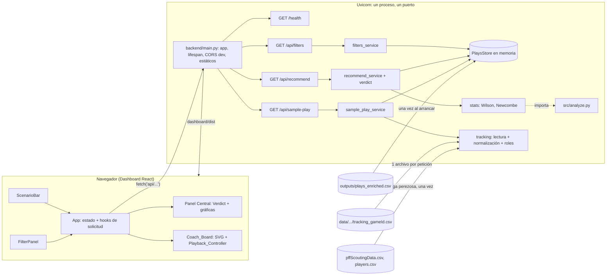
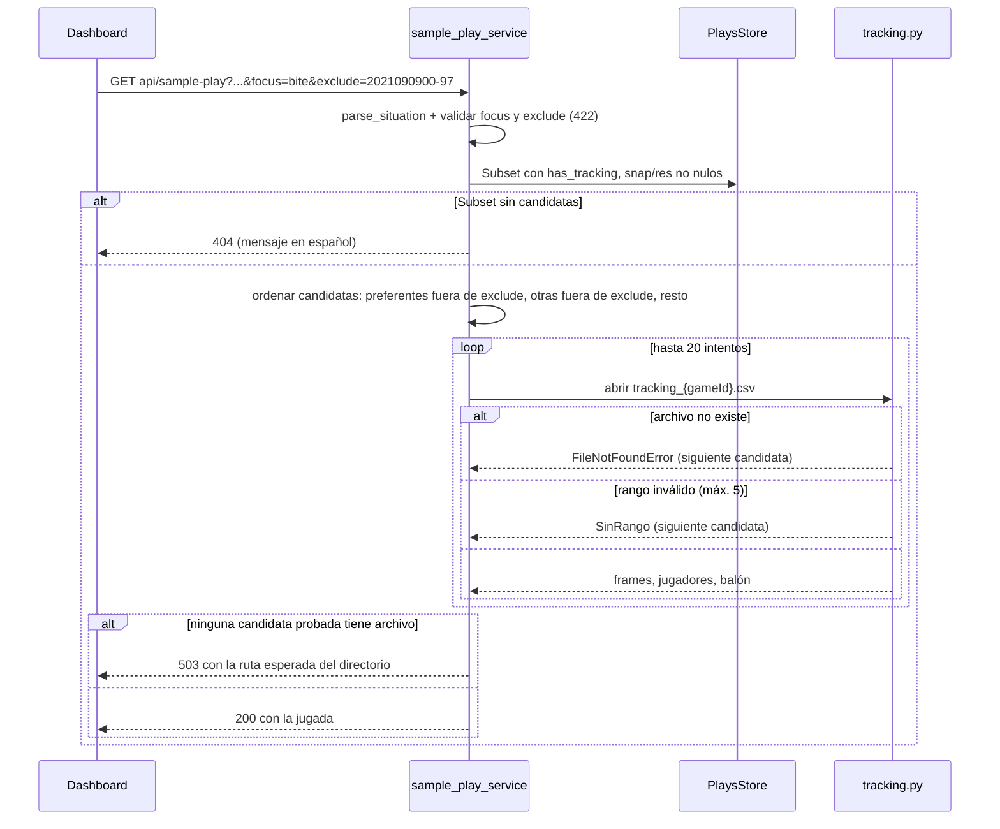
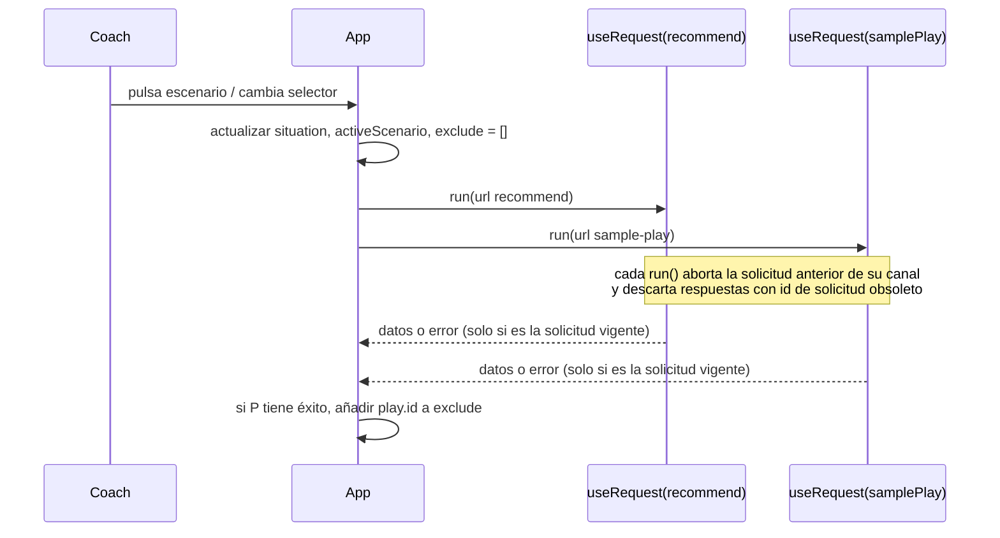

# Design Document: NFL Tactical Coach Simulator

## Overview

NFL Tactical Coach Simulator es una aplicación web de solo lectura para el perfil Coach. Un backend FastAPI carga una vez `outputs/plays_enriched.csv` (8,522 jugadas de pase, 122 partidos, temporada 2021, semanas 1 a 8) y expone tres endpoints de negocio bajo `/api`: filtros, recomendación y jugada real con tracking. Un dashboard React + TypeScript + Tailwind + Recharts consume esos endpoints con rutas relativas y se sirve desde el mismo puerto que la API. Además hay un script `src/plots.py` que genera tres figuras estáticas y un `README.md` ejecutivo.

### Estado verificado del proyecto

Esto se revisó en el workspace antes de escribir el diseño y condiciona las decisiones:

| Elemento | Estado verificado |
|---|---|
| `backend/main.py` | Solo `GET /health`. Hay que reemplazarlo conservando `app` y `/health`. |
| `.venv/`, `data/` | No existen en el workspace. El tracking, `pffScoutingData.csv` y `players.csv` no están disponibles aquí. |
| `dashboard/` | React 18.3.1, Vite 5.4.21, Tailwind 3.4.19, Recharts 3.10.1. `vite.config.ts` tiene `base: './'` pero **no tiene proxy de `/api`**. Hay que añadirlo (requisito 10.6). `App.tsx` es una plantilla. No hay `fetch` aún. |
| `package.json` | `build` = `tsc --noEmit && vite build`. No hay runner de pruebas de frontend y el stack fijo no permite añadir uno (vitest, jest). |
| `.hackathon/requirements.txt` | fastapi, uvicorn, pydantic, pandas, numpy, strands-agents, boto3, pytest, httpx. **No incluye matplotlib.** |
| `outputs/plays_enriched.csv` | 8,522 filas, `has_tracking` verdadero en todas. Sin nulos en `is_success`, `pff_playAction`, `is_blitz`, `any_pressure`, `prePenaltyPlayResult`, `pff_passCoverage`. Nulos: `time_to_throw` 486, `min_rusher_dist_at_throw` 465, `res_frameId` 464, `lb_bite_yards` 24, `snap_frameId` 24, `offenseFormation` 7, `defendersInBox` 7. `down` solo toma 1 a 4. `protection_advantage` va de -2 a 6. `defendersInBox` viene como flotante (`6.0`). |
| `src/analyze.py` | Ya implementa `wilson_ci` (z = 1.96) y `diff_props_ci` (IC híbrido de Newcombe, en proporciones). Es el método del requisito 4.7 y de `COACH_INSIGHTS.md`. |
| `src/tracking_metrics.py` | Define `SNAP_EVENTS`, `normalize_xy` (x → 120 − x, y → 53.3 − y cuando `playDirection = left`), `LB_POSITIONS`, `BITE_OFFSET_FRAMES = 10`, 10 Hz, y la definición exacta de `lb_bite_yards` y `min_rusher_dist_at_throw`. La pizarra debe reproducir esas definiciones para cumplir los criterios 17.25 y 17.26. |
| `tests/helpers.py` | `run_property(seed, n_iter, fn)`: ejecuta una propiedad con generador numpy sembrado y mínimo 100 iteraciones, sin hypothesis. Se reutiliza. |
| `.hackathon/rules.md` | Stack fijo, `fetch('api/...')` sin diagonal inicial, API bajo `/api`, `GET /health`, build servido en el mismo puerto, el servidor no depende de escribir en disco. |

### Decisiones de diseño principales

1. **Una sola fuente de verdad estadística.** El backend importa `wilson_ci` y `diff_props_ci` de `src.analyze` (envueltos en `backend/stats.py`, que solo convierte a pp y redondea). Así el servicio, `plots.py` y `COACH_INSIGHTS.md` usan las mismas fórmulas.
2. **El servicio calcula, el dashboard solo muestra.** Ninguna cifra de resultado vive en el código del dashboard (requisitos 16.7 y 16.22). Los Scenario_Preset solo guardan filtros y `focus`.
3. **Datos en memoria, tracking bajo demanda.** `plays_enriched.csv` se carga en el arranque. Tracking, `pffScoutingData.csv` y `players.csv` se leen solo en `/api/sample-play`.
4. **Degradación aislada.** Si falta el CSV, `/health` sigue en 200 y las rutas de negocio dan 503. Si falta el tracking, `/api/filters` y `/api/recommend` siguen en 200 y solo `/api/sample-play` falla.
5. **Cancelación en el cliente por canal.** Cada panel (recomendación, jugada, filtros) tiene su propio `AbortController` y su propio contador de solicitud, para que un fallo en un panel no afecte a los otros (criterios 11.10 y 16.20).

### Supuestos y decisiones abiertas (explícitos)

| # | Tema | Supuesto adoptado en este diseño | Quién decide / cuándo |
|---|---|---|---|
| A1 | **matplotlib** | `src/plots.py` importa matplotlib de forma perezosa y con backend `Agg`. matplotlib **no está en el stack fijo** (`rules.md`) y **no se añade** a `requirements.txt` ni se importa desde `backend/`. Si no está instalado, el script termina con código 2 y un mensaje en español que nombra la dependencia (criterio 14.10). El docstring declara que su uso está pendiente de decisión del equipo (14.11). Si el equipo lo aprueba, se instala solo en el entorno de quien genera las figuras, y los PNG se versionan en `outputs/`. Aviso al equipo: salirse del stack implica que AWS no hospedará la app; por eso la dependencia queda fuera del servidor. | Equipo, antes de generar las figuras para el README. |
| A2 | **Tracking ausente** | El directorio `data/nfl-big-data-bowl-regional-event-data/data/` no existe aquí. El diseño trata `/api/sample-play` como funcionalidad condicionada a que exista en la máquina de ejecución. Sin él: 503 con la ruta esperada (8.9), el Coach_Board muestra el mensaje y el resto de la app sigue operativa. Las pruebas que necesitan tracking real se omiten con `pytest.skip`; la lógica de lectura se prueba con archivos sintéticos pequeños creados en un directorio temporal de la prueba. | Verificar en la máquina de despliegue. |
| A3 | **Escenario 1: caja de 7 contra cualquier caja** | Se usa `Cover-2` + `defendersInBox = 7` (requisito 16.2), que da **+24.3 pp** (n = 94 y 105). El **+12.3 pp** corresponde a Cover-2 con cualquier número en la caja (n = 261 y 824). Ninguna de las dos cifras se escribe en el código. Un texto de la Scenario_Card indica "Caja de 7" para evitar que se lea como el valor general de Cover-2. Si el equipo prefiere citar +12.3 pp, basta quitar `defenders_in_box` del preset, sin cambiar el contrato. | Equipo, revisar antes de presentar. |
| A4 | **LB en "Avance de LB"** | El criterio 17.19 dice "jugadores con rol LB", pero `lb_bite_yards` se calcula en el pipeline sobre todos los defensores con `officialPosition` en `LB_POSITIONS`, incluidos los que hacen rush. Para que 17.25 se cumpla (diferencia ≤ 0.1 yd), cada jugador devuelto lleva además `is_lb` (definición del pipeline) y la métrica y las flechas de LB usan `is_lb`. El campo `role` conserva los seis valores del criterio 9.7, donde un LB que hace rush tiene rol `Pass Rush` (criterio 17.16). | Se documenta; no requiere decisión salvo que se prefiera la lectura literal. |
| A5 | **Evento de resolución** | El pipeline usa como resolución el primer evento de `pass_forward`, `autoevent_passforward`, `qb_sack` o `qb_strip_sack`. El requisito 9.3 pide `pass_forward`. Se usa `pass_forward` o `autoevent_passforward` en el tracking; si no existe, se cae a `res_frameId` del CSV (criterio 9.12), que puede ser un sack. En ese caso el criterio 17.26 puede no cumplirse con exactitud para esa jugada; las pruebas de consistencia seleccionan jugadas cuyo evento de resolución es `pass_forward`. | Documentado. |
| A6 | **Selección con `exclude`** | Orden de selección: preferentes fuera de `exclude`; si no hay, cualquier candidata fuera de `exclude` (`preferred = false`); si no hay, se ignora `exclude` (primero preferentes). Esto sigue literalmente 8.5 y 8.6; consecuencia: tras agotar las preferentes, la Scenario_Card puede mostrar "Jugada de ejemplo sin el patrón destacado" aunque existan preferentes ya vistas. | Documentado. |
| A7 | **Categorías de `protection_advantage`** | Los valores observados van de -2 a 6. La categoría `-2 a -1` agrupa valores ≤ -1 y `3 a 6` agrupa valores ≥ 3, de modo que ninguna jugada con valor no nulo queda fuera. | Documentado. |
| A8 | **Subset vacío** | Responde 200 con `subset_n = 0`, todos los grupos con n = 0 y Verdict con código `MUESTRA_INSUFICIENTE` (uno de los cuatro códigos permitidos por 7.1) y texto "No hay jugadas para la situación elegida." | Documentado. |
| A9 | **Modo desarrollo** | Se distingue por la variable de entorno `APP_ENV=dev`. Sin ella (producción), no se añade ningún middleware CORS. | Documentado. |

## Architecture



### Estructura de archivos

```
backend/
  __init__.py
  main.py              # app, lifespan, CORS dev, montaje de estáticos, rutas
  config.py            # rutas absolutas desde la raíz del proyecto, constantes
  store.py             # PlaysStore: carga, validación de columnas, columnas derivadas
  situation.py         # SituationFilter: validación (422) y máscara del Subset
  stats.py             # wilson, newcombe, redondeos (envuelve src.analyze)
  schemas.py           # modelos Pydantic de las respuestas
  filters_service.py
  recommend_service.py # grupos, tablas, diferencias
  verdict.py           # decisión y texto del Verdict
  tracking.py          # lectura por bloques, normalización, eventos, roles, etiquetas
  sample_play_service.py
src/plots.py           # figuras estáticas (matplotlib perezoso)
tests/                 # helpers.py (existente) + pruebas nuevas
dashboard/src/         # ver "Componentes del Dashboard"
README.md              # reporte ejecutivo
```

### Ciclo de vida y degradación

```mermaid
stateDiagram-v2
    [*] --> Cargando: arranque (lifespan)
    Cargando --> Listo: CSV con todas las columnas requeridas
    Cargando --> SinDatos: CSV ausente, ilegible o con columnas faltantes
    SinDatos: store.error = mensaje; se registra en stderr
    Listo: store.df cargado, 0 lecturas por petición
    Listo --> Listo: /api/filters, /api/recommend (sin disco)
    Listo --> Listo: /api/sample-play (lee 1 tracking)
    SinDatos --> SinDatos: /health = 200; /api/* = 503
```



- La carga ocurre en el `lifespan` de FastAPI, de forma síncrona, antes de aceptar la primera petición (1.1).
- Una excepción durante la carga se captura, se registra con `logging` hacia stderr (no a archivo, 10.8) y deja `store.error` con un texto en español. El proceso no termina (1.5).
- `/health` no depende del store (1.6).
- Los directorios de rutas se resuelven con `Path(__file__).resolve().parent.parent` (1.2). No se usa el directorio de trabajo.
- `StaticFiles(directory=dist, html=True)` se monta en `/` **después** de registrar `/health` y el router `/api`, y solo si `dashboard/dist` existe al arrancar (10.2 y 10.3). Las rutas registradas antes tienen prioridad sobre el montaje.
- CORS: solo si `APP_ENV=dev`, con `allow_origins=["http://localhost:5173"]`, `allow_methods=["GET"]` (10.9 y 10.10).
- Todos los endpoints de negocio son `def` (no `async`): FastAPI los ejecuta en el pool de hilos. La lectura de tracking no bloquea el bucle de eventos.

## Components and Interfaces

### Backend

#### `config.py`

```python
PROJECT_ROOT = Path(__file__).resolve().parent.parent
PLAYS_CSV    = PROJECT_ROOT / "outputs" / "plays_enriched.csv"
DATA_DIR     = PROJECT_ROOT / "data" / "nfl-big-data-bowl-regional-event-data" / "data"
TRACKING_DIR = DATA_DIR / "tracking"
DIST_DIR     = PROJECT_ROOT / "dashboard" / "dist"
MIN_N = 30; Z95 = 1.96
```

#### `store.py`: PlaysStore

Columnas requeridas: `gameId, playId, down, yardsToGo, possessionTeam, defensiveTeam, homeTeamAbbr, visitorTeamAbbr, week, offenseFormation, defendersInBox, pff_playAction, pff_passCoverage, pff_passCoverageType, prePenaltyPlayResult, is_success, is_blitz, any_pressure, protection_advantage, time_to_throw, min_rusher_dist_at_throw, lb_bite_yards, snap_frameId, res_frameId, has_tracking`.

Carga y columnas derivadas (una vez):

| Columna derivada | Regla |
|---|---|
| `ytg_bucket` | `corta` si 1 ≤ yardsToGo ≤ 3, `media` si 4 a 7, `larga` si ≥ 8 |
| `box_int` | `defendersInBox` como `Int64` (acepta nulos) |
| `bite_bin` | 0 a 3 con bordes 0.10, 0.69, 1.16, `[a, b)`; −1 si `lb_bite_yards` es nulo |
| `prot_cat` | `-2 a -1` (≤ −1), `0`, `1`, `2`, `3 a 6` (≥ 3); nulo si `protection_advantage` es nulo (A7) |
| `play_id` | texto `"{gameId}-{playId}"`, identificador usado en `exclude` |

Reglas del Subset base: se excluyen filas con `down` fuera de 1 a 4 (3.10) y filas con nulo en `pff_playAction`, `is_blitz` o `is_success` (hoy hay 0; se registra un aviso si hubiera alguna). Esto garantiza los invariantes 4.9 y 5.6.

`store.error: str | None` y `store.df: DataFrame | None`. Un decorador/dependencia `require_store()` lanza `HTTPException(503, "Los datos de jugadas no están disponibles. Revisa outputs/plays_enriched.csv.")`.

Los valores únicos de filtros se **precalculan** en la carga (`store.filter_values`) porque no cambian: así `/api/filters` es O(1).

#### `situation.py`: SituationFilter

```python
@dataclass(frozen=True)
class SituationFilter:
    down: str | None           # "1","2","3","4","3-4"
    yards_to_go_bucket: str | None
    coverage: str | None
    formation: str | None
    defenders_in_box: int | None

def parse_situation(raw: dict[str, str | None], store) -> SituationFilter  # lanza 422
def subset_mask(df, f: SituationFilter) -> pd.Series
```

Reglas de validación (3.1 a 3.8). Se validan **todos** los parámetros antes de lanzar, y el mensaje de 422 nombra todos los inválidos:

- Cadena vacía o ausente → criterio omitido.
- `down`: exactamente `"1","2","3","4","3-4"`. Cualquier otra cosa (0, −1, 5, `"a"`, `" 3"`) es inválida.
- `yards_to_go_bucket`: exactamente `corta|media|larga` (sensible a mayúsculas).
- `coverage`, `formation`: deben estar en `store.filter_values`. El mensaje incluye el valor recibido.
- `defenders_in_box`: debe convertirse a entero y estar en `store.filter_values["defendersInBox"]`. `"7"` y `"7.0"` son válidos; `"x"` no.
- El mensaje de error: `"Parámetro(s) inválido(s): down (valor '7'), coverage (valor 'Cover-9')."` en español, con HTTP 422 y cuerpo `{"detail": "...", "invalid": ["down", "coverage"]}`.

Se devuelve un `JSONResponse` propio con `{"detail": str, "invalid": [...]}`. Se evita el 422 automático de FastAPI para parámetros declarados con tipo, por eso todos los parámetros se declaran `str | None` y se validan a mano.

#### `stats.py`

```python
def wilson_pct(k, n) -> tuple[float, float] | None        # envuelve src.analyze.wilson_ci, ×100, 1 decimal
def newcombe_diff_pp(k1, n1, k0, n0) -> tuple[float, float, float] | None  # (diff, lo, hi) en pp, 1 decimal
def mean_or_none(series) -> tuple[float | None, int]      # (media redondeada, n no nulos)
def r1(x), r2(x), r3(x)                                   # None-safe, convierte -0.0 en 0.0
```

Fórmulas (z = 1.96), con p = k/n:

- **Wilson:** `centro = (p + z²/2n) / (1 + z²/n)`; `mitad = z·√(p(1−p)/n + z²/4n²) / (1 + z²/n)`; IC = `[max(0, centro − mitad), min(1, centro + mitad)]`.
- **Diferencia de proporciones (Newcombe híbrido):** con `p1, p0` y sus Wilson `(l1,u1)`, `(l0,u0)`: `d = p1 − p0`; `inf = d − √((p1−l1)² + (u0−p0)²)`; `sup = d + √((u1−p1)² + (p0−l0)²)`. Se multiplica por 100 para pp. Es el mismo método que `src.analyze.diff_props_ci` (16.14 y 18.4).
- Redondeo: se calcula con valores sin redondear y se redondea una sola vez al devolver, para que el signo del Effect_pp redondeado coincida con el de la diferencia de Success_Rate redondeada (7.9). `r1` normaliza `-0.0` a `0.0`.
- `diff_props_ci` exige n ≥ 2 en ambos grupos para dar IC. Con n = 1 el IC queda nulo; como el Verdict exige n ≥ 30 para decidir, no afecta la lógica.

#### `filters_service.py`

`GET /api/filters` devuelve:

```json
{
  "down": [1,2,3,4],
  "pff_passCoverage": ["2-Man","Bracket","Cover-0", "..."],
  "pff_passCoverageType": ["Man","Zone","Other"],
  "offenseFormation": ["EMPTY","I_FORM","..."],
  "defendersInBox": [1,2,3,4,5,6,7,8,9,10,11],
  "yards_to_go_buckets": [
    {"name":"corta","min":1,"max":3},
    {"name":"media","min":4,"max":7},
    {"name":"larga","min":8,"max":null}
  ]
}
```

Reglas: sin nulos ni cadenas vacías (2.2), `down` y `defendersInBox` numéricos ascendentes, enteros sin `.0` (2.3), el resto alfabético sin distinguir mayúsculas (2.1). Un campo sin valores devuelve `[]` sin afectar a los demás (2.6). Store sin datos → 503 sin listas parciales (2.5). Los valores se calculan sobre el Subset base (después de excluir `down = 0` y nulos obligatorios), para que cada valor devuelto tenga al menos una jugada (2.7).

#### `recommend_service.py`

`GET /api/recommend?down&yards_to_go_bucket&coverage&formation&defenders_in_box`

1. `parse_situation` → `SituationFilter` (422 si hay inválidos).
2. `sub = df[subset_mask]`. `n_subset = len(sub)`.
3. `pa = sub[pff_playAction == 1]`, `trad = sub[pff_playAction == 0]`, `bl = sub[is_blitz == 1]`, `std = sub[is_blitz == 0]`.
4. Estadísticos de grupo, tablas y diferencias (abajo).
5. `verdict = build_verdict(...)`.

Contrato de respuesta (JSON, `null` donde no hay valor):

```jsonc
{
  "subset_n": 187,
  "filter": {"down": "3-4", "yards_to_go_bucket": null, "coverage": "Cover-2", "formation": null, "defenders_in_box": 7},
  "play_action": {
    "play_action": {"n": 94, "successes": 70, "success_rate": 74.5, "ci": [64.8, 82.3],
                    "mean_yards": 7.12, "lb_bite": {"mean": 0.98, "n_used": 93},
                    "insufficient": false, "label": null},
    "traditional": {"n": 105, "...": "misma forma"},
    "effect_pp": 24.3,
    "effect_pp_ci": [12.1, 35.0],
    "effect_yards": 2.31
  },
  "blitz": {
    "blitz":    {"n": 265, "success_rate": 50.9, "ci": [44.9, 56.8],
                 "any_pressure_pct": 47.0,
                 "time_to_throw": {"mean": 2.60, "n_used": 254},
                 "min_rusher_dist": {"mean": 2.10, "n_used": 250},
                 "insufficient": false, "label": null},
    "standard": {"...": "misma forma"},
    "effect_pp": 4.3,
    "effect_pp_ci": [-2.3, 11.0],
    "pressure_pp": 13.5,
    "time_to_throw_diff": -0.29,
    "min_rusher_dist_diff": -0.40
  },
  "physics": {
    "lb_bite_table":   [{"range": "< 0.10", "lo": null, "hi": 0.10, "n": 40, "n_pa": 9, "n_trad": 31,
                         "pa_success_rate": 0.444, "trad_success_rate": 0.419,
                         "pa_pressure_rate": 0.222, "trad_pressure_rate": 0.258,
                         "insufficient": false, "label": null}, "..."],
    "protection_table": [{"category": "-2 a -1", "n": 3, "any_pressure": 0.667, "success_rate": 0.333,
                          "insufficient": true, "label": "Muestra insuficiente (n < 30)"}, "..."]
  },
  "verdict": {"code": "SIN_VENTAJA_CLARA", "text": "...", "effect_pp": -0.8, "effect_pp_ci": [-12.3, 11.5]}
}
```

(Los números son ilustrativos; no son valores de prueba.)

Reglas del contrato:

- Porcentajes de grupo (`success_rate`, `ci`, `any_pressure_pct`, `effect_pp`, `pressure_pp`): 0 a 100 con 1 decimal. Medias de yardas y segundos: 2 decimales. Tablas de física: proporciones 0.000 a 1.000 con 3 decimales (6.1 y 6.3). La mezcla de unidades viene de los requisitos; cada campo documenta su unidad en `schemas.py`.
- `insufficient = true` y `label = "Muestra insuficiente (n < 30)"` cuando `n < 30` (incluye n = 0, 4.6). Las métricas se siguen devolviendo cuando 0 < n < 30.
- n = 0: `success_rate`, `ci`, `mean_yards` y `lb_bite.mean` son `null`; `lb_bite.n_used = 0`. `effect_pp`, `effect_pp_ci` y `effect_yards` son `null` si algún grupo tiene n = 0 (4.8, 16.13).
- `play_action.effect_yards` = media de `prePenaltyPlayResult` de PA menos la de tradicional, 2 decimales (16.13). Se calcula con las medias sin redondear.
- `blitz.effect_pp_ci` usa `newcombe_diff_pp` con Blitz como grupo 1 (16.13 y 16.14).
- Medias de `lb_bite_yards`, `time_to_throw`, `min_rusher_dist_at_throw` excluyen solo nulos de **esa** métrica y devuelven su conteo (4.3, 5.2). Una diferencia es `null` si alguna de sus medias es `null` (5.4).
- `physics.lb_bite_table`: siempre 4 filas, en orden, con etiquetas `"< 0.10"`, `"0.10 a 0.69"`, `"0.69 a 1.16"`, `">= 1.16"`. `n` cuenta jugadas del Subset con `lb_bite_yards` no nulo en ese rango (PA + tradicional). `pa_success_rate` y `trad_success_rate` son `null` si ese grupo no tiene jugadas en la fila (6.5). Se añaden `n_pa` y `n_trad` (campos aditivos), y `pa_pressure_rate` y `trad_pressure_rate` (proporción de `any_pressure` por grupo, `null` si el grupo está vacío; aditivos, requisito 12.7). Las jugadas con `lb_bite_yards` nulo se excluyen de la tabla y de nada más (6.6).
- `physics.protection_table`: siempre 5 filas en el orden de 6.3. `any_pressure` y `success_rate` son `null` con n = 0.

Tamaño del trabajo: el Subset tiene como máximo 8,522 filas y todo son agregaciones vectorizadas de pandas. Se espera unos pocos milisegundos por petición, muy por debajo de 500 ms (1.7).

#### `verdict.py`: lógica de decisión

```mermaid
flowchart TD
    A[Entrada: grupos PA y tradicional, effect_pp y CI, filtro] --> B{subset_n = 0?}
    B -- sí --> V0[MUESTRA_INSUFICIENTE: 'No hay jugadas para la situación elegida.']
    B -- no --> C{n_pa < 30 o n_trad < 30?}
    C -- sí --> V1[MUESTRA_INSUFICIENTE: texto con n de cada grupo; effect nulo si algún n = 0]
    C -- no --> D{ci_lo > 0?}
    D -- sí --> V2[LLAMAR_PLAY_ACTION: 'LLAMAR PLAY ACTION (+X.X pp de éxito esperado)']
    D -- no --> E{ci_hi < 0?}
    E -- sí --> F{coverage = 'Red Zone'?}
    F -- sí --> V3[EVITAR_PLAY_ACTION: 'EVITAR PLAY ACTION EN RED ZONE (X.X pp menos éxito)']
    F -- no --> V4[EVITAR_PLAY_ACTION: 'EVITAR PLAY ACTION (X.X pp menos éxito)']
    E -- no --> V5[SIN_VENTAJA_CLARA: diferencia no concluyente]
    V2 --> N[Añadir nota de blitz si ambos n >= 30 y aclaración de éxito sin EPA]
    V3 --> N
    V4 --> N
    V5 --> N
```

Reglas adicionales:

- Solo `is_success` decide (7.8). `prePenaltyPlayResult` no interviene.
- El texto tiene como máximo 280 caracteres (7.1). Se compone de **titular + (opcional) nota de blitz + aclaración fija** `"Éxito por down y distancia; sin EPA."`. Si la suma supera 280 se omite la nota de blitz. El titular más largo (`MUESTRA_INSUFICIENTE`) es de unos 90 caracteres, por lo que el presupuesto se cumple en todos los casos. Una prueba lo verifica con valores extremos.
- Nota de blitz (7.7): `"Blitz: presión {+|-}X.X pp frente a cobertura estándar."`, solo si `blitz` y `standard` tienen n ≥ 30. Usa `blitz.pressure_pp`.
- Para `MUESTRA_INSUFICIENTE` con n_pa o n_trad igual a 0, `effect_pp` y `effect_pp_ci` del Verdict son `null` (7.6). Con 0 < n < 30 en algún grupo y ambos n > 0, se conservan los valores calculados (consistente con 4.5).
- Efecto y signo: el Verdict toma `effect_pp` ya redondeado desde la misma función que la diferencia de 4.7, nunca recalcula con otros datos (7.9).
- Con `LLAMAR_PLAY_ACTION` el texto empieza exactamente con `"LLAMAR PLAY ACTION (+"` seguido de X.X y `" pp de éxito esperado)"` (7.2). El valor se toma del Effect_pp con un decimal, que es positivo porque el límite inferior es mayor que 0.
- Se evitan los verbos prohibidos para resultados no concluyentes ("gana", "pierde", "supera", "mejora"). El texto de `SIN_VENTAJA_CLARA` es `"SIN VENTAJA CLARA: la diferencia de {+|-}X.X pp no es concluyente (el intervalo incluye 0)."`.

#### `tracking.py`

Funciones puras sobre DataFrames, para poder probarlas sin archivos reales:

```python
TRACKING_COLUMNS = ["gameId","playId","nflId","frameId","team","playDirection","x","y","s","a","event"]
SNAP_EVENTS = {"ball_snap","autoevent_ballsnap"}
PASS_EVENTS = {"pass_forward","autoevent_passforward"}
LB_POSITIONS = {"ILB","MLB","OLB","LB"}   # mismo conjunto que src.tracking_metrics (una prueba verifica la igualdad)

def read_play_tracking(path, game_id, play_id) -> DataFrame     # chunks de 100_000, usecols, filtra playId
def normalize_xy(df) -> DataFrame                               # x_norm, y_norm (idéntico a src.tracking_metrics)
def find_range(play_df, csv_snap, csv_res) -> tuple[int,int,list[str]]  # (snap, res, avisos) o lanza SinRango
def assign_roles(players_df, pff_roles, officials, offense_abbr) -> DataFrame
def make_label(role, position) -> str
```

Lectura (9.1, 9.2): `pd.read_csv(path, usecols=TRACKING_COLUMNS, dtype=..., chunksize=100_000)`; por cada bloque se filtra `playId == play_id` y se acumulan solo esas filas. Los archivos miden en promedio unas 68 mil filas (8.36 M / 122), así que normalmente hay un solo bloque. Se abre exactamente un archivo `tracking_{gameId}.csv`. Se omiten `time`, `dis`, `o`, `dir`, `jerseyNumber` y `nflId` nulo no se descarta hasta separar el balón.

Normalización (9.5, 9.6, 9.11): `x_norm = 120 − x` y `y_norm = 53.3 − y` si `playDirection == "left"`; si es `"right"` queda igual. Filas con otro valor de `playDirection` se excluyen y se registra un aviso. Como el ataque va siempre a +x, el Coach_Board dibuja el ataque hacia la derecha (9.11).

Rango de frames (9.3, 9.12, 9.13):

1. `snap` = primer `frameId` con evento en `SNAP_EVENTS`; `res` = primer `frameId ≥ snap` con evento en `PASS_EVENTS`.
2. Si falta alguno, se usa `snap_frameId` o `res_frameId` de Plays_Store y se emite un aviso (`logging.warning`) que nombra el evento ausente.
3. Si tampoco hay valor en Plays_Store, la jugada se descarta (`SinRango`) y el servicio prueba otra candidata, hasta 5 intentos.
4. Si `res < snap`, la jugada se descarta igual.
5. Se devuelven los frames `snap ≤ frameId ≤ res`, ordenados.

Roles (9.7). Fuente: `pffScoutingData.csv` (`pff_role`, `pff_positionLinedUp`) y `players.csv` (`officialPosition`), cargadas **una vez** de forma perezosa bajo un `threading.Lock` en el primer `/api/sample-play`, con `usecols` mínimas y filtradas a las jugadas de Plays_Store. Equipo: `team` es `home`/`away`; se mapea con `homeTeamAbbr` y `visitorTeamAbbr` del propio Plays_Store (no hace falta `games.csv`). Ofensiva = `possessionTeam`.

| Condición (primera que aplique) | `role` |
|---|---|
| `team == "football"` | `Football` (va en `ball`, no en `players`) |
| `pff_role == "Pass"` | `QB` |
| `pff_role == "Pass Rush"` | `Pass Rush` |
| `pff_role == "Pass Route"` | `Pass Route` |
| `pff_role == "Pass Block"` | `Pass Block` |
| `pff_role == "Coverage"` y `officialPosition ∈ LB_POSITIONS` | `LB` |
| `pff_role == "Coverage"` | `Coverage` |
| otro o sin fila PFF | se omite el jugador y se registra un aviso |

`is_lb = (equipo defensivo) y (officialPosition ∈ LB_POSITIONS)`, independiente de `role` (supuesto A4). `position = pff_positionLinedUp` (nulo si falta).

Etiquetas (17.12 a 17.17), función pura `make_label(role, position)`:

| `role` | `label` |
|---|---|
| `QB` | `"QB"` |
| `LB` | `"LB"` |
| `Pass Route` | `position` o `"WR"` |
| `Pass Rush` | `"Rush"` (aunque `position` sea LB o DL) |
| `Pass Block` | `position` o `"OL"` |
| `Coverage` | `position` o `"DB"` |

Se excluyen del listado de jugadores y de las métricas de velocidad las filas con `team == "football"` (9.9). La posición del balón se devuelve por frame en `ball`.

#### `sample_play_service.py`

`GET /api/sample-play?down&yards_to_go_bucket&coverage&formation&defenders_in_box&focus&exclude`



Preferencia (8.2 a 8.4 y 16.15 a 16.19):

| `focus` | Conjunto preferente |
|---|---|
| ausente | PA con `is_success = 1` y `lb_bite_yards ≥ 1.16` **unión** blitz con `any_pressure = 1` |
| `bite` | PA con `is_success = 1` y `lb_bite_yards ≥ 1.16` |
| `pa_fallida` | PA con `is_success = 0` |
| `blitz_exitoso` | Blitz con `is_success = 1` |
| otro | 422 que nombra `focus` |

- `exclude`: lista separada por comas de `play_id` (`gameId-playId`), máximo 100; con más de 100 → 422. Elementos con formato inválido se ignoran.
- Selección aleatoria con `random.choice` (la semilla no es relevante para el producto; las pruebas inyectan un `random.Random`).
- Orden de candidatas (A6): `pref \ exclude` → `resto \ exclude` → `pref` → `resto`. `preferred = true` solo si la jugada elegida pertenece al conjunto preferente.
- Intentos: hasta 20 aperturas de archivo (8.8) y hasta 5 descartes por rango inválido (9.13). Si se agotan los 5 por rango, error 503 "No hay jugada con tracking utilizable." (9.13). Si ningún archivo existe, 503 con la ruta (8.9).
- Subset sin candidatas (criterio 8.1): 404 con "No hay jugadas con tracking para la situación elegida." (8.7).

Respuesta:

```jsonc
{
  "preferred": true,
  "play": {
    "id": "2021090900-97", "gameId": 2021090900, "playId": 97, "week": 1,
    "offense": "TB", "defense": "DAL", "down": 3, "yards_to_go": 2,
    "coverage": "Cover-1", "formation": "SHOTGUN",
    "play_action": 0, "is_blitz": 1, "any_pressure": 1, "is_success": 0,
    "lb_bite_yards": 1.2, "min_rusher_dist_at_throw": 2.31, "time_to_throw": 3.2
  },
  "snap_frame": 6, "pass_forward_frame": 38,
  "frames": [6, 7, "..."],
  "players": [
    {"nflId": 25511, "role": "QB", "position": "QB", "label": "QB", "side": "offense", "is_lb": false,
     "track": [{"frameId": 6, "x_norm": 33.1, "y_norm": 26.0, "s": 0.2, "a": 0.4}, "..."]}
  ],
  "ball": [{"frameId": 6, "x_norm": 33.4, "y_norm": 26.1}, "..."]
}
```

Cada campo de `play` no disponible va como `null` (9.8). `s` y `a` nulos van como `null`. El tamaño aproximado es 22 jugadores × ≤ 60 frames, del orden de 100 KB, y la lectura está en el orden de cientos de milisegundos (objetivo 9.14: < 2 s).

### Componentes del Dashboard

```
dashboard/src/
  main.tsx, index.css, App.tsx
  api/client.ts            # getJson con AbortController, tiempo de espera de 10 s, ApiError
  api/types.ts             # tipos de las respuestas (reflejan los contratos de arriba)
  state/situation.ts       # tipo Situation, valores iniciales, toQuery()
  state/scenarios.ts       # los 3 Scenario_Preset: {id, texto, filtro, focus}; sin cifras de resultados
  hooks/useRequest.ts      # solicitud con cancelación, estado {status, data, error}, reintentar
  hooks/usePlayback.ts     # Playback_Controller
  lib/format.ts            # fmt1, fmt2, pct, dash para null
  lib/board.ts             # funciones puras: ventana visible, avance de LB, distancia QB–Rush
  components/
    ScenarioBar.tsx, FilterPanel.tsx, ScenarioCard.tsx
    VerdictCard.tsx, ComparisonCharts.tsx, PhysicsChart.tsx, ScopeFooter.tsx
    CoachBoard.tsx, FieldSvg.tsx, PlayerMarker.tsx, Legend.tsx
    PlaybackController.tsx, LiveMetrics.tsx, PlayMeta.tsx
    PanelState.tsx           # carga, error + Reintentar
```

#### Estado y flujo de solicitudes

Estado en `App.tsx` (React `useState`/`useReducer`; no se añade ninguna librería):

```ts
interface Situation { down: string; ytg: string; coverage: string; formation: string; box: string } // "" = Todos
interface AppState {
  situation: Situation
  activeScenario: ScenarioId | null
  exclude: string[]        // play_id ya mostrados, máximo 100 (se conservan los últimos 100)
  focus: Focus | null      // focus vigente (solo con un escenario activo)
}
```

Tres canales independientes con `useRequest`: `filters` (una sola vez al montar), `recommend` y `samplePlay`.



`useRequest` (criterios 11.7 a 11.10):

- Mantiene `requestId` en un `useRef`. `run(url)` incrementa el contador, llama `abort()` del controlador anterior y crea otro.
- Al terminar la solicitud, solo aplica el resultado si `id === requestId.current`. Un `AbortError` causado por una nueva solicitud se ignora y no muestra error.
- Tiempo de espera: `setTimeout(() => { timedOut = true; ctrl.abort() }, 10_000)`. Si `timedOut`, se trata como error: `"La solicitud tardó demasiado. Intenta de nuevo."`
- Estados: `idle | loading | ok | error`. En `loading` y `error` se **conserva el último `data`** para mostrarlo (11.8). La interfaz muestra el indicador de carga encima, no lo reemplaza.
- `retry()` vuelve a ejecutar con la URL calculada **en ese momento** desde el estado vigente (11.9), no la URL fallida guardada.
- Al desmontar se aborta.
- Los errores se traducen a mensajes en español: red → `"No se pudo conectar con el servidor."`; HTTP 422/404/503 → el `detail` en español de la API; otros → `"Error del servidor (código N)."`.

Reglas de los eventos de interfaz:

| Evento | Efecto |
|---|---|
| Cambio de selector | `situation` actualizado, `activeScenario = null`, `focus = null`, `exclude = []`, `run(recommend)`, `run(samplePlay)` |
| "Restablecer" | Todo en "Todos", `activeScenario = null`, `exclude = []`, **una** ejecución de recommend y una de sample-play |
| Escenario | `situation` = filtro del preset, `activeScenario = id`, `focus`, `exclude = []`, ejecuta ambas con `focus` (16.2 a 16.5). `aria-pressed="true"` en el botón activo |
| "Cargar otra jugada real" | `run(samplePlay)` con `exclude` actual; botón `disabled` mientras `status === 'loading'` (13.8) |
| Fallo en sample-play (404/503) | La pizarra muestra el mensaje y **conserva** la última jugada dibujada (13.10); el resto de paneles no cambia |

Las URLs se construyen con `URLSearchParams`, omitiendo valores vacíos. Siempre se usa `fetch('api/recommend?...')` sin diagonal inicial (10.4). Un script de verificación (ver Testing Strategy) busca en el código fuente rutas con `'/api`, `"/api`, `localhost`, `127.0.0.1`, `http://`, `https://` en referencias.

#### Presets (`state/scenarios.ts`)

```ts
export const SCENARIOS = [
  { id: 'play_action_cover2_caja7', texto: 'Play Action vs Cover-2 (Caja de 7)',
    filtro: { down: '', ytg: '', coverage: 'Cover-2', formation: '', box: '7' }, focus: 'bite' },
  { id: 'trampa_red_zone', texto: 'La Trampa de Red Zone',
    filtro: { down: '', ytg: '', coverage: 'Red Zone', formation: '', box: '' }, focus: 'pa_fallida' },
  { id: 'blitz_empty', texto: 'Blitz vs Formación Empty',
    filtro: { down: '', ytg: '', coverage: '', formation: 'EMPTY', box: '' }, focus: 'blitz_exitoso' },
] as const
```

La Scenario_Card (`ScenarioCard.tsx`) renderiza, según `activeScenario`, solo campos de la respuesta de `/api/recommend` (16.7 a 16.12):

- `play_action_cover2_caja7`: `effect_pp` e IC, `n` de ambos grupos, `lb_bite.mean` de ambos (2 decimales). Línea fija "Caja de 7" (A3).
- `trampa_red_zone`: `effect_yards` (2 decimales), `effect_pp` e IC, `verdict.code`.
- `blitz_empty`: `blitz.success_rate` y `ci`, `time_to_throw.mean` con `n_used`, `blitz.effect_pp` con `effect_pp_ci`, y n de ambos grupos.
- Etiqueta `"no concluyente"` junto a cualquier diferencia cuyo IC cumpla `lo ≤ 0 ≤ hi` (16.11). Los textos del escenario describen con "se asocia con" o "diferencia de", nunca con "gana", "pierde", "supera" ni "mejora".
- Etiqueta `"Muestra insuficiente (n < 30)"` junto a cada grupo con `insufficient` (16.12).
- Si `samplePlay.preferred === false`: `"Jugada de ejemplo sin el patrón destacado"` (16.17).
- Pie fijo: `"Éxito medido por down y distancia; sin EPA. Una sola jugada ilustra, no prueba."` (16.21).
- Se cierra al cambiar un selector o pulsar "Restablecer" (16.6).

#### Panel central (gráficas)

`ComparisonCharts.tsx` usa `BarChart` de Recharts 3.10.1:

- Gráfica 1: Success_Rate (%) y media de `prePenaltyPlayResult` (yardas) de Play Action contra Tradicional. Dos `BarChart` pequeños con ejes distintos para evitar mezclar unidades. El Wilson_CI se dibuja con `<ErrorBar dataKey="err" />`, donde `err = [valor − lo, hi − valor]`.
- Gráfica 2: Success_Rate (%) y `any_pressure` (%) de Blitz contra No Blitz.
- `PhysicsChart.tsx`: dos `BarChart`: éxito y presión por rango de `lb_bite_yards` (PA y tradicional) y por categoría de `protection_advantage`.
- `<LabelList>` muestra `n=…` junto a cada barra (12.5). Los grupos `insufficient` usan `<Cell fillOpacity={0.4}>` y el texto de advertencia (12.6).
- Un valor `null` omite la barra (el dato se pasa como `null`, que Recharts no dibuja) y la etiqueta muestra "–" (12.8).
- `subset_n === 0`: se oculta Verdict y gráficas y se muestra "No hay jugadas para la situación elegida." (12.9).
- `VerdictCard`: color por código: `LLAMAR_PLAY_ACTION` verde, `EVITAR_PLAY_ACTION` rojo, `SIN_VENTAJA_CLARA` ámbar, `MUESTRA_INSUFICIENTE` gris (12.2).
- Tema oscuro: fondo `slate-900` (#0f172a) y texto `slate-100` (#f1f5f9), contraste ≈ 16:1. Los textos secundarios usan `slate-300` (≈ 11:1). Prohibido `slate-500` o más oscuro sobre fondo oscuro en el Panel Central (12.11). Tailwind 3 con `darkMode: 'class'` ya fijado en `index.html` (`<html class="dark">`) o directamente colores oscuros por clase.
- Pie `ScopeFooter`: "Solo jugadas de pase, 8 semanas de la temporada 2021, sin EPA." (12.10).

#### Coach_Board (SVG)

`CoachBoard` recibe la respuesta de sample-play y compone `FieldSvg`, `PlayerMarker`, `Legend`, `PlaybackController`, `LiveMetrics` y `PlayMeta`.

**Sistema de coordenadas.** El SVG usa `viewBox` en yardas: `x_norm` hacia la derecha, `y_norm` de 0 a 53.3. SVG tiene el eje y hacia abajo; se dibuja `y = y_norm` directamente (la orientación vertical de la pizarra es una convención; se mantiene sin invertir para que el QB y las posiciones conserven la relación del tracking). La ventana visible se calcula con `lib/board.ts`:

```ts
function viewWindow(players, ball, margin = 3) {
  // mínimo y máximo de x_norm, y_norm sobre TODOS los frames de snap a pass_forward
  // → { x0: minX - 3, x1: maxX + 3, y0: max(0, minY - 3), y1: min(53.3, maxY + 3) }
}
```

Ajuste del criterio 13.6: la ventana contiene todas las posiciones con 3 yardas de margen en cada borde. Si la ventana resultante queda más ancha que alta, se conserva la proporción 1:1 de yardas ampliando el lado corto, de modo que un margen mayor nunca invalida el criterio.

**Elementos**:

- `FieldSvg`: césped, líneas cada 5 yardas (`x = 5k` en coordenadas absolutas de campo) y números cada 10 yardas, recortados a la ventana (13.1). `x_norm` es coordenada absoluta de campo (0 a 120, con zonas de anotación de 10 yardas); los números de yarda se calculan como `min(x−10, 110−x)` para `x` múltiplo de 10 entre 20 y 100.
- Jugadores: marcador con color + forma únicos por rol (13.3):

| Rol | Forma | Color |
|---|---|---|
| QB | estrella | amarillo |
| Pass Route | triángulo | azul |
| Pass Block | cuadrado | cian |
| Pass Rush | rombo | rojo |
| Coverage | círculo | naranja |
| LB | hexágono | magenta |

  La leyenda lista los 6 roles con su símbolo. Los colores se eligen distinguibles también en escala de grises por la forma.
- Trayectoria por jugador: `polyline` desde `snap` hasta `pass_forward` con trazo tenue (13.2); se dibuja completa y el marcador se coloca en el frame vigente.
- Flechas de LB (13.4): para cada jugador con `is_lb`, una flecha de su posición en `snap` a su posición en `pass_forward`, y el texto `lb_bite_yards` con 1 decimal (`–` si es nulo).
- Línea QB–Pass Rush más cercano (13.5): en `pass_forward`, entre el QB y el jugador con rol `Pass Rush` más cercano, con la etiqueta `min_rusher_dist_at_throw` con 1 decimal. Si no hay QB o Pass Rush, no se dibuja.
- `Player_Label` encima de cada marcador, uno por jugador (17.11). Tamaño de texto: 1.6 yardas para QB, LB y Rush; 1.1 yardas para Pass Route, Pass Block y Coverage (17.18).
- `PlayMeta`: equipo ofensivo y defensivo, semana, down, yardas, cobertura, formación, Play Action, Blitz y éxito. Los ausentes dicen "No disponible" (13.7).
- Texto fijo: "Jugada real de ejemplo: ilustra, no prueba, la tendencia" (13.12).
- Cuando sample-play falla se muestra el mensaje de la API sin borrar la última jugada (13.10).

**Métricas en vivo** (`lib/board.ts`, funciones puras):

```ts
// Avance de LB en el frame f (17.19): promedio sobre jugadores con is_lb de (x_norm en snap − x_norm en f)
liveLbAdvance(players, snap, f): number | null
// Distancia QB–Rush más cercano en el frame f (17.20): mínimo de la distancia euclidiana
liveQbRushDist(players, f): number | null
```

Ambas devuelven `null` ("–") cuando no hay LB, QB o Pass Rush (17.23). `liveLbAdvance` promedia solo los LB que tienen posición en `snap` y en `f`, igual que `lb_bite` del pipeline. Referencias (17.21 y 17.22): con `f = snap + 10` aparece `"Referencia lb_bite_yards (1 s tras el snap)"` con el valor de la API; con `f = pass_forward` aparece la referencia de `min_rusher_dist_at_throw`.

#### Playback_Controller (`hooks/usePlayback.ts`)

```mermaid
stateDiagram-v2
    [*] --> Pausa: jugada cargada, frame = snap
    Pausa --> Reproduciendo: "Reproducir" (si frame = pass_forward, reinicia en snap)
    Reproduciendo --> Pausa: "Pausa", mover deslizador, "Ir a pass_forward", cargar jugada o cambiar filtro
    Reproduciendo --> Pausa: frame = pass_forward (auto)
    Pausa --> Pausa: mover deslizador / "Ir a pass_forward"
    note right of Reproduciendo: setInterval 100 ms: frame += 1
```

- Estado: `frame: number`, `playing: boolean`. `frames` = `snap..pass_forward` de la respuesta.
- `setInterval(100)` dentro de un `useEffect` que depende de `playing` y de la identidad de la jugada. Se limpia en el cleanup, al desmontar y al cambiar la jugada (17.10). El avance usa la forma funcional `setFrame(f => ...)` para no acumular desfases.
- Al cambiar `play.id` se hace `playing = false` y `frame = snap` (17.3).
- Etiqueta del deslizador: `"Tiempo desde el snap: " + ((frame - snap) / 10).toFixed(1) + " s"` (17.2).
- Si `frames.length === 1`: botón y deslizador `disabled` y se muestra ese frame (17.24).
- Los botones "Cargar otra jugada real" y "Restablecer" y los selectores siguen operativos mientras se anima (17.27); la animación vive solo dentro de `CoachBoard`.
- Los marcadores se obtienen indexando `track` por `frameId` (se construye un `Map<frameId, punto>` por jugador al recibir la jugada, con `useMemo`).

### `src/plots.py`

```python
"""Figuras estáticas. Nota: matplotlib no pertenece al stack fijo y su uso está pendiente de la decisión del equipo."""
```

Estructura:

1. `load_plays(path)` valida existencia y columnas requeridas (`pff_passCoverage, lb_bite_yards, defendersInBox, protection_advantage, any_pressure, is_success` más `pff_playAction`, `is_blitz`). Falta archivo (14.9) o columna (14.13) → mensaje en español y `sys.exit(1)`, sin tocar ningún PNG.
2. `import matplotlib` dentro de un `try`. Falta → mensaje en español que nombra `matplotlib` y `sys.exit(2)` antes de escribir cualquier PNG (14.10).
3. Funciones de cálculo **sin matplotlib** (probables con pytest): `cells_fig1(df)`, `cells_fig2(df)`, `cells_fig3(df)`. Devuelven DataFrames con n, diferencia en pp, IC y bandera `no_concluyente`. Usan `src.analyze.wilson_ci` y `diff_props_ci`.
4. Funciones de dibujo: `draw_fig1/2/3(cells, out_path)`; todas las cadenas visibles en español.
5. Se renderiza primero todo en memoria y solo después se escribe, para no dejar un conjunto parcial si falla la tercera figura. Escritura con `fig.savefig(path, dpi=300)` (14.2) sobrescribiendo (14.1).
6. Al final imprime las tres rutas y `sys.exit(0)` (14.8).

Contenido: fig1 diferencia PA menos tradicional por `pff_passCoverage` con IC y etiqueta "no concluyente" si n < 30 en alguno (14.4); fig2 diferencia por rango de `lb_bite_yards` y por `defendersInBox` con n visible (14.5); fig3 `any_pressure` y Success_Rate por `protection_advantage` para Blitz y No Blitz (14.6). `plots.py` no abre tracking (14.3).

### `README.md` (requisito 18)

Secciones en orden: "Resumen del problema" (≤ 150 palabras), "Metodología", "Hallazgos principales" (exactamente tres, cada uno con una de las figuras `outputs/fig1_...png`, `fig2_...png`, `fig3_...png`, texto alternativo en español, rutas relativas sin `/` inicial), "Limitaciones", "Cómo correr la app". Reglas editoriales: verbos de asociación, sin "causa" ni "garantiza"; solo hallazgos con IC que excluye 0 y n ≥ 30, o marcados "no concluyente"; sin credenciales; `localhost` y `127.0.0.1` solo dentro de bloques de código; máximo 1,200 palabras sin código ni tablas. Si las imágenes aún no existen al redactar, se deja una nota visible con el comando `python src/plots.py` (18.13, dependiente de A1). Cifras tomadas de `outputs/COACH_INSIGHTS.md` dentro de 0.1 pp y 0.01 yd. Los tres hallazgos concretos se eligen al implementar, leyendo `COACH_INSIGHTS.md` (hay candidato claro: la diferencia total de Success_Rate de +6.8 pp).

"Cómo correr la app" incluye bloques copiables:

```bash
python3 -m venv .venv && .venv/bin/pip install -r .hackathon/requirements.txt
.venv/bin/uvicorn backend.main:app --port 8000          # API + dashboard/dist
cd dashboard && npm install && npm run dev               # desarrollo, con APP_ENV=dev en el backend
cd dashboard && npm run build                            # genera dashboard/dist
.venv/bin/python src/plots.py                            # requiere matplotlib (decisión A1)
```

### Configuración del dashboard a modificar

- `vite.config.ts`: conservar `base: './'` y añadir `server: { proxy: { '/api': 'http://localhost:8000' } }` (10.6). Esa es la única aparición permitida de `localhost`, y está en configuración, no en código servido.
- `tailwind.config.js` e `index.css`: se revisan al implementar; no se cambia la versión de Tailwind.
- Ningún `import` de recursos externos ni fuentes por URL (10.5).

## Data Models

### Tablas fuente

| Fuente | Uso | Cuándo se lee |
|---|---|---|
| `outputs/plays_enriched.csv` | Plays_Store: toda la lógica de filtros y recomendación | Al arrancar, una vez |
| `data/.../tracking/tracking_{gameId}.csv` | Coordenadas de la jugada elegida | Por petición a sample-play, 1 archivo |
| `data/.../pffScoutingData.csv` | `pff_role`, `pff_positionLinedUp` | Primera petición a sample-play, luego en caché |
| `data/.../players.csv` | `officialPosition` (para `is_lb`) | Primera petición a sample-play, luego en caché |

### Modelos Pydantic (`schemas.py`)

```python
class Ci(BaseModel): lo: float; hi: float          # se serializa como [lo, hi] con un alias de lista

class MeanStat(BaseModel): mean: float | None; n_used: int

class PaGroup(BaseModel):
    n: int; successes: int; success_rate: float | None; ci: list[float] | None
    mean_yards: float | None; lb_bite: MeanStat; insufficient: bool; label: str | None

class BlitzGroup(BaseModel):
    n: int; success_rate: float | None; ci: list[float] | None; any_pressure_pct: float | None
    time_to_throw: MeanStat; min_rusher_dist: MeanStat; insufficient: bool; label: str | None

class Verdict(BaseModel):
    code: Literal["LLAMAR_PLAY_ACTION","EVITAR_PLAY_ACTION","SIN_VENTAJA_CLARA","MUESTRA_INSUFICIENTE"]
    text: str; effect_pp: float | None; effect_pp_ci: list[float] | None

class RecommendResponse(BaseModel):
    subset_n: int; filter: dict; play_action: PlayActionBlock; blitz: BlitzBlock
    physics: Physics; verdict: Verdict

class TrackPoint(BaseModel): frameId: int; x_norm: float; y_norm: float; s: float | None; a: float | None
class PlayerTrack(BaseModel):
    nflId: int; role: Role; position: str | None; label: str; side: Literal["offense","defense"]
    is_lb: bool; track: list[TrackPoint]
class SamplePlayResponse(BaseModel):
    preferred: bool; play: PlayMeta; snap_frame: int; pass_forward_frame: int
    frames: list[int]; players: list[PlayerTrack]; ball: list[BallPoint]
```

Los pares de intervalo se serializan como listas de dos números `[lo, hi]`. Los tipos TypeScript de `api/types.ts` reflejan estos modelos campo a campo.

### Tipos del Dashboard (extracto)

```ts
type Role = 'QB' | 'Pass Route' | 'Pass Block' | 'Pass Rush' | 'Coverage' | 'LB'
type VerdictCode = 'LLAMAR_PLAY_ACTION' | 'EVITAR_PLAY_ACTION' | 'SIN_VENTAJA_CLARA' | 'MUESTRA_INSUFICIENTE'
type Focus = 'bite' | 'pa_fallida' | 'blitz_exitoso'
type Pair = [number, number] | null
```

### Reglas de grupos y rangos (resumen)

| Concepto | Regla |
|---|---|
| Play_Action_Group / Traditional_Group | `pff_playAction == 1` / `== 0` |
| Blitz_Group / Standard_Group | `is_blitz == 1` / `== 0` |
| Yards_To_Go_Bucket | corta 1–3, media 4–7, larga ≥ 8 |
| Rangos de `lb_bite_yards` | `[min, 0.10)`, `[0.10, 0.69)`, `[0.69, 1.16)`, `[1.16, max]` |
| Categorías de `protection_advantage` | `-2 a -1`, `0`, `1`, `2`, `3 a 6` (A7) |
| Muestra insuficiente | n < 30 → "Muestra insuficiente (n < 30)" |
| Normalización | `playDirection = left` → `x_norm = 120 − x`, `y_norm = 53.3 − y` |
| Rango de frames | `ball_snap` a `pass_forward`, ambos inclusive, 10 Hz |


## Correctness Properties

*A property is a characteristic or behavior that should hold true across all valid executions of a system-essentially, a formal statement about what the system should do. Properties serve as the bridge between human-readable specifications and machine-verifiable correctness guarantees.*

### Reflexión de propiedades

Del análisis previo se consolidaron las propiedades redundantes:

- 4.9 y 5.6 (particiones del Subset) comparten estructura y se unen en una propiedad.
- 4.1, 4.2 y 4.10 (Wilson) se unen: el cálculo coincide con la fórmula y cumple el orden `lo ≤ tasa ≤ hi`.
- 4.7, 4.8, 5.5, 16.13 y 16.14 (diferencias) se unen en una propiedad de diferencias con nulidad.
- 4.3, 4.4, 5.2 y 5.4 (medias con nulos) se unen.
- 4.5, 4.6 y 6.4 (etiqueta de muestra insuficiente) se unen.
- 7.2 a 7.4 y 7.8 (texto) se unen con la longitud máxima. 7.1, 7.5 y 7.6 (código) se unen en una propiedad de decisión.
- 8.1 a 8.6 y 16.15 a 16.19 (selección de jugada) se unen en una propiedad de selección.
- 9.5, 9.6, 9.10 y 9.11 (normalización) se unen en la propiedad de ida y vuelta.
- 17.12 a 17.17 y 9.7 (rol y etiqueta) se unen.
- 13.6 (ventana visible) y 17.19 y 17.20 (métricas en vivo) son lógica pura de TypeScript y se prueban con el ejecutor de pruebas incorporado de Node, sin añadir dependencias.
- Los criterios de interfaz, despliegue, rendimiento y datos reales quedan como pruebas de ejemplo, de humo o de integración, no como propiedades.

### Property 1: Los valores de filtros están bien formados y existen en los datos

*For any* DataFrame de jugadas (con nulos, cadenas vacías, mayúsculas mixtas y `down = 0`), la lista de cada campo devuelta por el servicio de filtros no contiene nulos ni cadenas vacías, no tiene duplicados, está en orden ascendente (numérico para `down` y `defendersInBox`, alfabético sin distinguir mayúsculas para los demás), `defendersInBox` y `down` son enteros, y cada valor aparece en al menos una jugada del Subset base.

**Validates: Requirements 2.1, 2.2, 2.3, 2.7**

### Property 2: El Subset es exactamente el conjunto de jugadas que cumplen todos los criterios

*For any* DataFrame de jugadas y *for any* Situation_Filter válido (cada criterio ausente, vacío o con un valor válido, incluidos `down = "3-4"`), el Subset calculado por `subset_mask` es igual al conjunto de jugadas con `down` entre 1 y 4 que cumplen cada criterio presente, calculado fila por fila con un oráculo independiente, y un criterio ausente o vacío no restringe el resultado.

**Validates: Requirements 3.2, 3.3, 3.4, 3.10**

### Property 3: Los filtros inválidos se rechazan con 422 y se nombran todos

*For any* combinación de parámetros en la que al menos uno está fuera de su dominio (incluidos `down` = 0, negativos, mayores que 4 o texto, `yards_to_go_bucket` con otra capitalización, y valores de cobertura, formación o caja inexistentes), la respuesta es HTTP 422, el mensaje en español nombra cada parámetro inválido y la respuesta no contiene datos de recomendación.

**Validates: Requirements 3.5, 3.6, 3.7, 3.8**

### Property 4: Los grupos particionan el Subset

*For any* DataFrame de jugadas y *for any* Situation_Filter válido, `n(Play Action) + n(Tradicional) = tamaño del Subset` y `n(Blitz) + n(Estándar) = tamaño del Subset`.

**Validates: Requirements 4.9, 5.6**

### Property 5: El intervalo de Wilson coincide con la fórmula y es coherente

*For any* par `(k, n)` con `n > 0` y `0 ≤ k ≤ n`, el intervalo devuelto coincide con la fórmula de Wilson con z = 1.96 (tolerancia de redondeo a un decimal en porcentaje), cumple `0 ≤ lo ≤ tasa ≤ hi ≤ 100` y la tasa devuelta es `100·k/n` redondeada a un decimal.

**Validates: Requirements 4.1, 4.2, 4.10**

### Property 6: Las diferencias coinciden con el cálculo directo y son nulas si falta un grupo

*For any* Subset, `effect_pp` es `100·(p_PA − p_trad)` con intervalo de Newcombe igual al de `src.analyze.diff_props_ci`, `blitz.effect_pp_ci` se calcula con el mismo método con Blitz como grupo 1, `play_action.effect_yards` es la media de `prePenaltyPlayResult` de PA menos la de tradicional, y todas esas diferencias (y las de `any_pressure`, `time_to_throw` y `min_rusher_dist_at_throw`) son nulas cuando alguno de los dos grupos, o alguna de las medias implicadas, no tiene valores.

**Validates: Requirements 4.7, 4.8, 5.4, 5.5, 16.13, 16.14**

### Property 7: Las medias excluyen solo los nulos de su métrica

*For any* columna con valores nulos y no nulos, la media devuelta es la media de los valores no nulos, `n_used` es el número de valores no nulos (entre 0 y el n del grupo), y si no hay valores no nulos la media es nula y `n_used` es 0.

**Validates: Requirements 4.3, 4.4, 5.2**

### Property 8: La etiqueta de muestra insuficiente depende solo de n

*For any* grupo o fila de tabla con tamaño `n`, `insufficient` es verdadero exactamente cuando `n < 30`, en ese caso la etiqueta es "Muestra insuficiente (n < 30)", para `0 < n < 30` las métricas se conservan, y para `n = 0` las métricas son nulas.

**Validates: Requirements 4.5, 4.6, 5.3, 6.4**

### Property 9: La tabla de `lb_bite_yards` asigna cada valor a un único rango

*For any* Subset con valores de `lb_bite_yards` (incluidos nulos y los bordes 0.10, 0.69 y 1.16), la tabla siempre tiene 4 filas en orden, cada valor no nulo cae en exactamente un rango `[a, b)` (los bordes pertenecen al rango superior), la suma de `n` de las filas es igual al número de jugadas del Subset con `lb_bite_yards` no nulo, y una tasa de un grupo sin jugadas en la fila es nula sin omitir la fila.

**Validates: Requirements 6.1, 6.2, 6.5, 6.6**

### Property 10: La tabla de `protection_advantage` siempre tiene cinco filas completas

*For any* Subset, la tabla de protección tiene exactamente 5 filas en el orden `-2 a -1`, `0`, `1`, `2`, `3 a 6`, la suma de `n` es igual al número de jugadas con `protection_advantage` no nulo, y cada fila con `n = 0` tiene tasas nulas.

**Validates: Requirements 6.3, 6.5, 6.6**

### Property 11: El código del Verdict se decide solo por n y el intervalo

*For any* par de tamaños `(n_PA, n_trad)` y *for any* intervalo `[lo, hi]` de Effect_pp, el código es `MUESTRA_INSUFICIENTE` si algún n es menor que 30; en otro caso es `LLAMAR_PLAY_ACTION` si `lo > 0`, `EVITAR_PLAY_ACTION` si `hi < 0` y `SIN_VENTAJA_CLARA` si `lo ≤ 0 ≤ hi`. Si algún grupo tiene n = 0, `effect_pp` e intervalo del Verdict son nulos. El código es siempre uno de los cuatro permitidos.

**Validates: Requirements 7.1, 7.2, 7.3, 7.5, 7.6**

### Property 12: El texto del Verdict tiene el formato y el límite exigidos

*For any* entrada del Verdict, el texto tiene como máximo 280 caracteres, contiene la aclaración de que el éxito se mide por down y distancia y que no hay EPA, `LLAMAR_PLAY_ACTION` empieza con "LLAMAR PLAY ACTION (+X.X pp de éxito esperado)" con X.X igual al Effect_pp con un decimal, `EVITAR_PLAY_ACTION` incluye el valor absoluto con un decimal seguido de "pp" y empieza con "EVITAR PLAY ACTION EN RED ZONE" si y solo si la cobertura es `Red Zone`, el texto de `MUESTRA_INSUFICIENTE` incluye el n de cada grupo, y la nota de blitz con la diferencia de `any_pressure` aparece solo cuando ambos grupos de blitz tienen n ≥ 30.

**Validates: Requirements 7.1, 7.2, 7.3, 7.4, 7.6, 7.7, 7.8**

### Property 13: El signo del Effect_pp del Verdict coincide con la diferencia de Success_Rate

*For any* conteos `(k_PA, n_PA, k_trad, n_trad)` con ambos n > 0, el signo del `effect_pp` del Verdict es igual al signo de la diferencia de Success_Rate devuelta por la comparativa, tratando como iguales los valores que redondean a 0.0.

**Validates: Requirements 7.9**

### Property 14: La selección de jugada respeta tracking, preferencia, `focus` y `exclude`

*For any* DataFrame de jugadas, *for any* `focus` (ausente o válido) y *for any* lista `exclude`, la jugada elegida pertenece al Subset, tiene `has_tracking` verdadero y `snap_frameId` y `res_frameId` no nulos; si el conjunto preferente (según `focus`, o según 8.2 y 8.3 sin `focus`) tiene alguna jugada fuera de `exclude`, la elegida pertenece a él y `preferred` es verdadero; si no, y existe alguna candidata fuera de `exclude`, la elegida está fuera de `exclude` con `preferred = false`; si todas están en `exclude`, se elige una de ellas. Un `focus` fuera de `bite`, `pa_fallida` y `blitz_exitoso` produce 422 que nombra `focus`.

**Validates: Requirements 8.1, 8.2, 8.3, 8.4, 8.5, 8.6, 16.15, 16.16, 16.17, 16.18**

### Property 15: El recorte de tracking devuelve solo la jugada y el rango pedidos

*For any* tracking sintético con varias jugadas, frames y eventos, el resultado contiene solo filas de la jugada elegida, los frames van de `ball_snap` a `pass_forward` ambos inclusive en orden ascendente, el balón no aparece en la lista de jugadores y sí en `ball`, y si falta un evento se usan `snap_frameId` y `res_frameId` del CSV con un aviso, o se descarta la jugada cuando tampoco están en el CSV o el rango es inválido.

**Validates: Requirements 9.1, 9.3, 9.9, 9.12, 9.13**

### Property 16: La normalización de coordenadas es una ida y vuelta

*For any* `x` en [0, 120], `y` en [0, 53.3] y `playDirection` en {`left`, `right`}, `x_norm` y `y_norm` son `120 − x` y `53.3 − y` si la dirección es `left` y `x` y `y` si es `right`, y aplicar la normalización inversa devuelve `x` e `y` con diferencia absoluta menor o igual a 0.01.

**Validates: Requirements 9.5, 9.6, 9.10, 9.11**

### Property 17: Cada jugador tiene un solo rol y la etiqueta sigue la tabla

*For any* combinación válida de `pff_role`, `officialPosition`, `pff_positionLinedUp` (incluido nulo) y equipo, el jugador recibe exactamente un rol de {`QB`, `Pass Route`, `Pass Block`, `Pass Rush`, `Coverage`, `LB`} y la etiqueta es: "QB" para QB, "LB" para LB, "Rush" para Pass Rush aunque `position` sea LB o DL, y `position` (o "WR", "OL", "DB" si es nulo) para Pass Route, Pass Block y Coverage.

**Validates: Requirements 9.7, 17.12, 17.13, 17.14, 17.15, 17.16, 17.17**

### Property 18: Las métricas en vivo siguen su definición

*For any* jugada con posiciones por frame, el "Avance de LB" en el frame `f` es el promedio, sobre los jugadores con `is_lb` que tienen posición en el snap y en `f`, de `x_norm(snap) − x_norm(f)`; la "Distancia QB–Rush más cercano" es el mínimo de la distancia euclidiana entre el QB y los jugadores `Pass Rush` en `f`; y ambas son nulas cuando falta QB, LB o Pass Rush.

**Validates: Requirements 17.19, 17.20, 17.23**

### Property 19: La ventana visible contiene todas las posiciones con margen

*For any* conjunto de posiciones de jugadores y balón en todos los frames de `ball_snap` a `pass_forward`, la ventana calculada contiene cada posición con al menos 3 yardas de margen en cada borde, salvo donde el borde coincide con el límite del campo (y entre 0 y 53.3).

**Validates: Requirements 13.6**

### Property 20: Las celdas de las figuras suman al total y marcan las muestras pequeñas

*For any* DataFrame de jugadas, las celdas calculadas para las figuras 1 y 2 tienen n que suman el número de jugadas con valor no nulo en la columna de agrupación, la diferencia de cada celda coincide con `diff_props_ci`, y una celda tiene la marca "no concluyente" si y solo si n < 30 en alguno de los dos grupos.

**Validates: Requirements 14.4, 14.5, 14.6**

## Error Handling

| Situación | Respuesta del Backend | Respuesta del Dashboard |
|---|---|---|
| CSV ausente, ilegible o con columnas faltantes | El proceso sigue vivo. Se registra el archivo o las columnas en stderr. `/health` = 200. `/api/filters`, `/api/recommend`, `/api/sample-play` = 503 con "Los datos de jugadas no están disponibles." (1.5) | Panel afectado con mensaje en español y "Reintentar" |
| Parámetro inválido (`down`, bucket, cobertura, formación, caja, `focus`, `exclude` con más de 100) | 422 con `{"detail": "...", "invalid": [...]}` en español, sin calcular nada (3.5 a 3.8, 16.18) | Muestra el `detail`; los selectores son listas cerradas, así que solo ocurre con URL manual |
| Subset vacío | 200 con n = 0 y Verdict `MUESTRA_INSUFICIENTE` (3.9, A8) | "No hay jugadas para la situación elegida", sin Verdict ni gráficas (12.9) |
| Sin candidatas con tracking en el Subset | 404 "No hay jugadas con tracking para la situación elegida." (8.7) | Mensaje en el Coach_Board; conserva la última jugada (13.10) |
| Directorio o archivos de tracking ausentes | 503 con la ruta esperada, tras probar hasta 20 candidatas (8.8, 8.9). `/api/filters` y `/api/recommend` siguen en 200 (15.6) | Igual que el caso anterior |
| Jugada sin `ball_snap`/`pass_forward` | Usa `snap_frameId`/`res_frameId` del CSV con un aviso; si tampoco hay, descarta y prueba otra (máx. 5); si se agotan, 503 "No hay jugada con tracking utilizable." (9.12, 9.13) | Igual |
| Jugador sin fila PFF | Se omite del listado y se registra un aviso | Ninguno |
| `playDirection` inválido | Se excluyen las filas y se registra un aviso | Ninguno |
| `s` o `a` nulos | Se devuelven como `null` | Sin efecto en la animación |
| Excepción no controlada | Manejador global devuelve 500 `{"detail": "Error interno del servidor."}` sin detalles internos; el traceback va a stderr | Mensaje "Error del servidor (código 500)." y Reintentar |
| Red caída o espera de 10 s agotada | n/a | Mensaje en español, botón "Reintentar", se conservan datos y selectores previos (11.8) |
| Respuesta obsoleta (el coach cambió el filtro) | n/a | Se descarta sin mostrar error (11.10) |
| Fallo parcial al pulsar un escenario | n/a | Error solo en el panel cuya solicitud falló; el otro panel conserva su resultado (16.20) |

Reglas generales:

- Ningún mensaje contiene rutas internas, salvo el 503 de tracking que muestra la ruta esperada por requisito (8.9).
- El Backend no escribe en disco: sin archivos de registro, sin cachés en archivo, sin temporales (10.8). El registro usa `logging` con salida a stderr.
- Todo texto visible al usuario, incluidos los `detail` de la API, está en español.

## Testing Strategy

### Enfoque dual

- **Pruebas unitarias y de ejemplo:** casos concretos, errores, contrato de despliegue y datos reales.
- **Pruebas de propiedades:** las 20 propiedades anteriores.
- Pruebas de humo y estáticas para los requisitos de despliegue, README y cifras prohibidas en el código fuente.

### Pruebas de propiedades

PBT **aplica** a este diseño: hay funciones puras con entradas amplias (filtros, estadística, Verdict, normalización, selección, roles, métricas en vivo, celdas de figuras).

- **Biblioteca (Python):** el proyecto ya tiene `tests/helpers.py` con `run_property(seed, n_iter, fn)`, que usa un generador sembrado de numpy y fuerza mínimo 100 iteraciones. **hypothesis no está en el stack fijo**, así que no se añade ni se escribe una biblioteca nueva: se usa este ayudante existente. Cada propiedad se implementa con **una sola** llamada a `run_property` y mínimo 100 iteraciones.
- **Propiedades de TypeScript (18 y 19):** `lib/board.ts` es TypeScript sin dependencias ni sintaxis que no se pueda borrar, y se prueba con el ejecutor incorporado de Node (`node --test` y `--experimental-strip-types`, disponibles en Node 22), sin añadir paquetes. El generador es un PRNG sembrado simple dentro de la prueba. Los archivos viven en `dashboard/tests/` y se excluyen de `tsconfig` para que `npm run build` no cambie. Un envoltorio de pytest (`tests/test_board_ts.py`) los ejecuta con `subprocess` y se omite si `node` no existe.
- **Etiqueta:** cada prueba lleva un comentario con el formato `# Feature: nfl-tactical-coach-simulator, Property N: <texto de la propiedad>`.
- **Generadores:** `make_plays_df(rng)` crea DataFrames de 0 a 300 filas con las columnas requeridas, valores en los dominios reales, nulos en las columnas que los admiten, `down = 0` y valores borde (`lb_bite_yards` en 0.10, 0.69, 1.16). `make_filter(rng)` genera filtros válidos; `make_bad_filter(rng)` genera valores fuera de dominio. Las pruebas del Verdict generan `(n_PA, n_trad, lo, hi)` incluyendo n = 0, 29, 30 y límites iguales a 0. El tracking sintético se genera en un directorio temporal de la prueba (`tmp_path`), nunca en el proyecto.

### Mapa propiedad → archivo de prueba

| Archivo | Propiedades |
|---|---|
| `tests/test_filters.py` | 1 |
| `tests/test_situation.py` | 2, 3 |
| `tests/test_recommend_props.py` | 4, 5, 6, 7, 8, 9, 10 |
| `tests/test_verdict.py` | 11, 12, 13 |
| `tests/test_sample_play_select.py` | 14 |
| `tests/test_tracking.py` | 15, 16, 17 |
| `dashboard/tests/board.test.ts` (+ `tests/test_board_ts.py`) | 18, 19 |
| `tests/test_plots_cells.py` | 20 |

### Pruebas de ejemplo y de integración

- **Requisito 3 (casos de error, 15.5):** una prueba por cada rama de 422 con `TestClient` (httpx ya está en el stack).
- **Invariantes 4.9, 4.10, 5.6, 9.10 (15.5):** cubiertos por las propiedades 4, 5 y 16.
- **Datos reales** (se omiten con `pytest.skip` si falta `outputs/plays_enriched.csv`): filtro vacío da n = 2,024 y 6,498 y diferencia 6.809 ± 0.01 pp (4.11); `any_pressure` 47.3% y 33.8% ± 0.1 (5.7); los tres escenarios con las tolerancias de 16.22 (n = 94 y 105 y +24.3 ± 0.1; n = 80 y 278, -1.79 ± 0.01, -0.8 ± 0.1 y código `SIN_VENTAJA_CLARA`; n = 265, 50.9 ± 0.1 y 2.60 ± 0.01).
- **I/O (1.3, 15.6):** espía sobre `open` y `pandas.read_csv` durante `/api/filters` y `/api/recommend`; con `TRACKING_DIR` inexistente ambos responden 200.
- **Estados de error del store (1.5, 1.6):** `monkeypatch` de la ruta del CSV y del contenido para cada rama.
- **Tracking (8.8, 8.9, 9.2):** directorio temporal sin archivos (503 con la ruta), con solo el archivo de la tercera candidata (éxito tras 2 fallos), y con un archivo sintético de más de 100,000 filas para confirmar que se lee por bloques.
- **Consistencia con el pipeline (17.25, 17.26):** con tracking real y jugadas cuyo evento de resolución es `pass_forward` (A5), se compara el "Avance de LB" en `snap + 10` con `lb_bite_yards` y la distancia QB–Rush con `min_rusher_dist_at_throw` (≤ 0.1). Se omite si no hay tracking (A2).
- **Contrato de despliegue (10.x):** `TestClient` comprueba que no hay rutas de negocio fuera de `/api` (salvo `/health`), que sin `APP_ENV=dev` no hay cabecera CORS y que con él solo se permite `http://localhost:5173`; que `dashboard/dist` ausente no impide arrancar; y una revisión del código fuente de `backend/` confirma las dependencias permitidas (10.7) y la ausencia de escrituras a disco (10.8).
- **Rendimiento (1.7, 9.14):** medición de 100 peticiones secuenciales y de una lectura de tracking real; informativa, no se ejecuta en la suite por defecto.
- **Verificación estática del Dashboard** (`tests/test_dashboard_source.py`): ninguna llamada `fetch` con ruta que empiece con `/`; ninguna aparición de `localhost`, `127.0.0.1`, `http://` o `https://` en `dashboard/src` ni en `dashboard/dist` (si existe); `vite.config.ts` conserva `base: './'` y el proxy de `/api`; las cadenas "12.3", "24.3", "1.8", "50.9" y "2.60" no aparecen en `dashboard/src` como texto o constante de resultado; no aparecen "gana", "pierde", "supera" ni "mejora" en los textos de la Scenario_Card (16.7, 16.11).
- **Compilación (15.1, 15.2):** `npm run build` en `dashboard/` y `python -c "import backend.main"` con `.venv`.
- **plots.py (14.x):** cálculo de celdas probado sin matplotlib (propiedad 20); ejecución completa solo si matplotlib está instalado (A1), con comprobación de los tres PNG, de los 300 DPI (chunk `pHYs` del PNG) y del código de salida 0; ejecuciones con CSV ausente, columna faltante y matplotlib ausente simulado, comprobando código de salida distinto de 0, mensaje en español y que no se creó ningún PNG. Celdas conocidas de `COACH_INSIGHTS.md` (n idénticos y diferencias ≤ 0.01 pp) se comparan con las calculadas, omitidas si el CSV falta.
- **README (18.15):** `tests/test_readme.py` verifica las cinco secciones y su orden, que cada ruta de imagen existe (o hay la nota de 18.13), ausencia de "causa", "garantiza", credenciales y `localhost` fuera de bloques de código, máximo 1,200 palabras sin código ni tablas, y las cifras de los tres hallazgos contra `COACH_INSIGHTS.md`.
- **Interfaz (requisitos 11 a 13, 16, 17):** el stack fijo no incluye un ejecutor de pruebas de componentes, así que la interfaz se valida con `tsc --noEmit`, `npm run build` y un guion de verificación manual: selección de filtros, cancelación (cambiar el filtro con una solicitud en curso), error con "Reintentar" (apagar el backend), los tres escenarios, reproducción y pausa, deslizador y "Ir a pass_forward", y contraste del tema oscuro. Es una limitación conocida: la lógica de la UI que sí es pura (propiedades 18 y 19, `toQuery`) se prueba con Node como se indicó.

### Orden de implementación sugerido

1. `config`, `store`, `situation`, `stats`, `filters_service` y sus pruebas.
2. `recommend_service`, `verdict` y sus pruebas de propiedades; comprobar los datos reales de 4.11, 5.7 y 16.22.
3. `tracking`, `sample_play_service` y pruebas con tracking sintético.
4. Dashboard: cliente y `useRequest`, panel de control, panel central, escenarios, pizarra y reproducción.
5. `src/plots.py` y `README.md` (dependen de la decisión A1 para generar los PNG).
